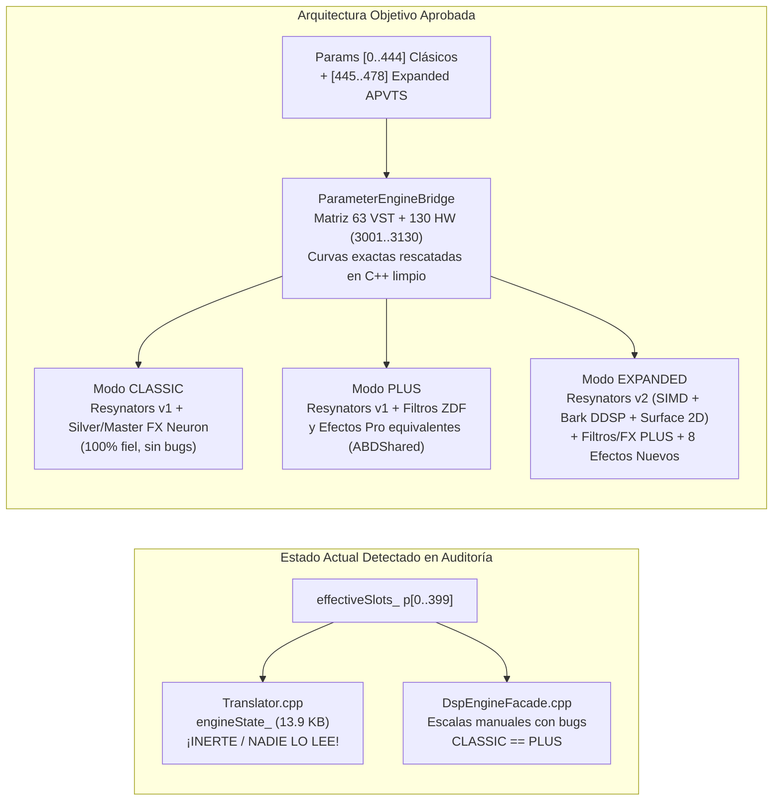

# Auditoría Técnica Integral y Plan Maestro de Evolución — `ABDAxionikVS`, `ABDShared` y `ABDNeuModMakr`

> **Fecha de actualización:** 12 de noviembre de 2026  
> **Repositorios coordinados:**  
> - `ABDAxionikVS` (`D:/desarrollos/ABDSynths/ABDAxionikVS` — `VST3` / `Standalone` / `WASM` / `WebUI`)  
> - `ABDShared` (`D:/desarrollos/ABDSynths/ABDShared` — `DspCore`, `DspEffects`, `NeuronVS`, `NeuronAnalysis`)  
> - `ABDNeuModMakr` (`D:/desarrollos/ABDSynths/ABDNeuModMakr` — generador de modelos `.model` v1 y `.axionik.model` v2)  
> **Corpus de referencia RE:** `C:/Users/ajaba/Downloads/neuron` (`NeuronVS.dll` v1.0 PC, `NeuronVS` Mac 1.56, `Neuron80GB-OS15` y manuales oficiales Hartmann).  
> **Estado:** Aprobado para implementación por olas optimizadas por modelo Gemini (`3.8 Flash`, `4 Argon`, `4 Carbon` en variantes `low`, `medium`, `high`).

---

## 1. Resumen Ejecutivo y Decisiones Arquitectónicas Cerradas

`ABDAxionikVS` cuenta con una base de ingeniería inversa extraordinariamente sólida (esquema exacto de 445 parámetros, observadores desensamblados, traductor `FUN_10040550` verificado bit a bit en reposo sobre 351 presets, primitivas modales de `CResynator`, filtro Silver de 5 modos, Slicer y Reverb híbrida). Sin embargo, la auditoría extremo a extremo del flujo real de señal y control desde `sound.script` / MIDI / WebUI hasta la muestra estéreo final reveló una arquitectura partida en dos (*Split-Brain*), errores de escala e imagen estéreo, ~115 parámetros desconectados y un modo `PLUS` todavía idéntico a `CLASSIC`.

### 1.1 Las 4 Decisiones de Arquitectura Aprobadas

1. **Eliminación limpia del *Split-Brain* (`Translator.cpp` → funciones C++ limpias en el camino vivo):**
   - Hoy [`ParameterEngineBridge`](file:///d:/desarrollos/ABDSynths/ABDAxionikVS/Source/DSP/ParameterEngineBridge.cpp#L850-L925) ejecuta en cada movimiento las 1.544 líneas de [`translateParametersToEngine`](file:///d:/desarrollos/ABDSynths/ABDAxionikVS/Source/DSP/Translator.cpp#L349-L1540) (`FUN_10040550`) escribiendo un bloque crudo `engineState_[3487]` (`13.948 B`) que **nadie lee en el motor de audio**, mientras [`DspEngineFacade::syncParametersToVoicePool`](file:///d:/desarrollos/ABDSynths/ABDAxionikVS/Source/DSP/DspEngineFacade.cpp#L472-L928) recalcula a mano curvas incompletas o con doble normalización.
   - **Solución adoptada:** extraer todas las fórmulas matemáticas exactas ya resueltas en [`Translator.cpp`](file:///d:/desarrollos/ABDSynths/ABDAxionikVS/Source/DSP/Translator.cpp) y en `100343e4_FUN_100343e4.c` a helpers C++20 limpios, legibles y tipados consumidos directamente por `DspEngineFacade`, y **desactivar en tiempo real el volcado crudo a `engineState_`** (conservándolo únicamente bajo demanda para pruebas offline de regresión). El flag `StrictLegacyParity` queda reservado en exclusiva para los tests offline contra WAVs *golden*.
2. **Definición cerrada de los 3 Modos de Síntesis (`CLASSIC`, `PLUS`, `EXPANDED`):**
   - **`CLASSIC`:** Equivalente fiel al **Hartmann Neuron / NeuronVS sin errores** (Resynators v1 clásicos + filtros y efectos originales del Neuron reparados, todos los parámetros `0..444` y los 130 destinos `3001..3130` del teclado hardware operativos).
   - **`PLUS`:** **Motor Resynator v1 clásico (100 % compatible con todos los bancos y presets clásicos `0..444`), pero sustituyendo los filtros y efectos por equivalentes modernos de mayor calidad** de `ABDShared` conectados a los mismos controles `0..444`.
   - **`EXPANDED` (`Extended`):** **Resynators v2 propios mejorados** (modelos de `ABDNeuModMakr` con banco aditivo fasorial SIMD de 256–512 parciales, residuo DDSP de 24 bandas Bark, transitorios y `UnifiedSpectralSurface`) + **todos los filtros y efectos de alta calidad de `PLUS`** + **8 nuevos efectos extra verificados de `ABDShared`**.
3. **Exposición en `APVTS` y Matriz de Modulación a partir del índice `445+`:**
   - Los índices `0..444` permanecen **100 % intactos** para no alterar jamás un preset, banco, NRPN clásico ni volcado SysEx del Neuron.
   - A partir del parámetro **`445`** se registran en `APVTS` (y `WasmBridge`) los **18 controles de Resynator v2** (`9 Shapers × R1` + `9 Shapers × R2`) y los controles/selectores de los nuevos efectos de `EXPANDED`, habilitando automatización en cualquier DAW, MIDI Learn $N:M$ y modulación interna desde LFO, envolventes y Matriz en modo `EXPANDED`.
4. **Plan Coordinado Multi-Repositorio (`ABDShared` + `ABDNeuModMakr` + `ABDAxionikVS`):**
   - Todos los arreglos en primitivas compartidas (`ABDShared`), el generador de modelos (`ABDNeuModMakr`) y el plugin/WebUI/WASM (`ABDAxionikVS`) se abordan en un único plan sincronizado.

---

### 1.2 Top 12 Hallazgos Críticos (`P0` / `P1`) en el Sintetizador + Hallazgos en `ABDShared`

| # | Severidad | Subsistema | Hallazgo Verificado | Ubicación Exacta |
|---:|:---:|---|---|---|
| **1** | **P0** | Etapa Master | **Corrupción estéreo total en canal derecho:** `tiltR` suma `inL` en lugar de `inR` como señal directa fundamental, destruyendo el panorama, el Stereo Spread, el L/R Delay y la imagen estéreo global; además usa ganancias `4.5 / 0.35` en lugar de las canónicas `5.0 / 3.0`. | [`DspNeuronMasterFX.h`](file:///d:/desarrollos/ABDSynths/ABDShared/Code/DspEffects/DspNeuronMasterFX.h#L238-L239) |
| **2** | **P0** | LFO / Pan (`getSlotRaw`) | **Doble normalización catastrófica:** `getSlotRaw()` devuelve exactamente el mismo valor ya normalizado `[0..1]` que `getSlotNorm()`. Al volver a dividir `LFORate [258]` entre `1000.0f`, el LFO queda congelado entre **`0.05 Hz` y `0.075 Hz`** (1.000× más lento). `SoundPan [3]` y `SoundPanKeyTrack [4]` se dividen dos veces entre `64.0f` (`< 1.6 %` de recorrido). | [`DspEngineFacade.h`](file:///d:/desarrollos/ABDSynths/ABDAxionikVS/Source/DSP/DspEngineFacade.h#L303-L308), [`DspEngineFacade.cpp`](file:///d:/desarrollos/ABDSynths/ABDAxionikVS/Source/DSP/DspEngineFacade.cpp#L481-L508) |
| **3** | **P0** | Matriz `Free Controllers` (`[363..410]`) | **Tabla de destinos `3000..3130` errónea e incompleta + shift de CCs:** el código asume `3001 + modDestId` (`3001..3063`, tabla VST2 de 63 destinos) y descarta `3064..3130`. En realidad, `3001..3130` es la **tabla hardware de 130 destinos** (`3001=SoundPan`, `3005=R1Volume`, `3031=Blender`, `3036..3090=Silver FX`, `3091..3130=Shapers/4L4T`), dejando el 100 % de las rutas `3001..3130` mal apuntadas o ignoradas. Además, `Controller1Dn..Controller4` están desplazados 1 índice MIDI CC (`CC 11` huérfano y `CC 1` dispara `Up` y `Down` a la vez). | [`ParameterEngineBridge.h`](file:///d:/desarrollos/ABDSynths/ABDAxionikVS/Source/DSP/ParameterEngineBridge.h#L166-L254), [`MatrixDrawer.ts`](file:///d:/desarrollos/ABDSynths/ABDAxionikVS/WebUI/src/ui/MatrixDrawer.ts#L92-L162), [`ControllersPanel.ts`](file:///d:/desarrollos/ABDSynths/ABDAxionikVS/WebUI/src/ui/ControllersPanel.ts#L165-L210) |
| **4** | **P0** | `ABDNeuModMakr` (`.scape` / `.sphere` v1) | **Modelos v1/Plus exportados con onda senoidal fija:** `serializeNeuronScapeBinary` ignora `partialMagnitudes` del análisis y escribe una plantilla fija tipo `511.model` (3 ciclos `1/h` + 61 senos puros). Como `CResynator` mezcla **90 % `.scape` + 10 % `.sphere`**, los modelos propios pierden casi toda su identidad tímbrica en `CLASSIC` y `PLUS`. Además, la tabla de `25 × 4` bandas de `.sphere` escribe una rampa estática ficticia. | [`ScapeSphereGenerator.ts`](file:///d:/desarrollos/ABDSynths/ABDShared/Code/DspCore/NeuronAnalysis/ScapeSphereGenerator.ts#L484-L597) |
| **5** | **P0** | Modos `CLASSIC` / `PLUS` / `EXPANDED` | **Hoy solo existen 2 motores reales:** `PLUS` declara capacidades `filter-v2` y `fx-v2`, pero carece de implementación C++ para los filtros/efectos mejorados y redirige a `NeuronVoicePool` ejecutando **exactamente el mismo DSP que `CLASSIC`**. | [`DspEngineFacade.h`](file:///d:/desarrollos/ABDSynths/ABDAxionikVS/Source/DSP/DspEngineFacade.h#L174-L184), [`AxionikExpandedModel.h`](file:///d:/desarrollos/ABDSynths/ABDAxionikVS/Source/DSP/Extended/AxionikExpandedModel.h#L1015-L1195) |
| **6** | **P0** | `Resynator v2` (`EXPANDED`) | **Potencial de `ABDNeuModMakr` desaprovechado en C++:** `morphY` está comentado; `UnifiedSpectralSurface` (Fase 38) se parsea pero jamás se evalúa; `residualBandsDb` (24 bandas Bark DDSP) y `hybridTransient` emiten ruido blanco plano sin filtrar; los parciales se truncan a `48` por usar `sin/pow/log2` por muestra; `dispatchRegion` reserva `std::vector` en `noteOn` (no RT-safe); y el motor ignora envolventes, filtro por voz, Blender, PitchBend y afinación de `R1`/`R2`. | [`AxionikExpandedSynthesizer.h`](file:///d:/desarrollos/ABDSynths/ABDAxionikVS/Source/DSP/Extended/AxionikExpandedSynthesizer.h#L479-L750) |
| **7** | **P1** | `Parset` vs `R1Type`/`R2Type` | **Conmutar la vista `Sphere/Scape` muta el algoritmo DSP:** `R1Type [24]` y `R2Type [104]` (selectores visuales del Stick) sobrescriben `CResynator::setParset(0..1)`, haciendo **inalcanzables los Parsets `2..9`** y cambiando el timbre al alternar de pestaña. Además, `NeuronBankAdapter` inventa `parameterSet = slot % 10` en vez de leer la cabecera real del modelo. | [`DspEngineFacade.cpp`](file:///d:/desarrollos/ABDSynths/ABDAxionikVS/Source/DSP/DspEngineFacade.cpp#L576-L579), [`NeuronBankAdapter.h`](file:///d:/desarrollos/ABDSynths/ABDAxionikVS/Source/DSP/NeuronBankAdapter.h#L290) |
| **8** | **P1** | Sample Rate (`48 / 88.2 / 96 kHz`) | **Frecuencia de muestreo fijada a `44.1 kHz`:** `DspNeuronSilverFilter` (`static` sin `sampleRate`), `DspNeuronSilverTimeFX`, `DspNeuronGlobalSlicer`, `CResynator::warmLp_` y el buffer Haas de `AxionikExpandedSynthesizer` asumen 44,1 kHz, desplazando frecuencias de corte y tiempos de retardo en proyectos a 48 o 96 kHz. | [`DspNeuronSilverFilter.h`](file:///d:/desarrollos/ABDSynths/ABDShared/Code/DspEffects/DspNeuronSilverFilter.h#L173-L364), [`DspNeuronSilverRack.h`](file:///d:/desarrollos/ABDSynths/ABDShared/Code/DspEffects/DspNeuronSilverRack.h#L760-L773) |
| **9** | **P1** | Envolventes ADSR y `4L4T` | **Doble atenuación por velocidad, curvas de 8 s vs 20 s y ausencia total de `4L4T`:** `DspNeuronEnvelope` multiplica siempre sus 7 envolventes por `velocity_` incluso con `*VelocityDepth = 0`; usa `norm^2.2 · 8 s` y sustain lineal frente a `f³·20 s` (Attack), `f²·20 s` (Decay/Release) y `2s - s²` (Sustain) del original; y los 12 parámetros `4L4T [242..252, 254]` están completamente muertos en audio. | [`DspNeuronEnvelope.h`](file:///d:/desarrollos/ABDSynths/ABDShared/Code/DspCore/DspNeuronEnvelope.h#L81-L165), [`DspEngineFacade.cpp`](file:///d:/desarrollos/ABDSynths/ABDAxionikVS/Source/DSP/DspEngineFacade.cpp#L645-L700) |
| **10** | **P1** | Parámetros Muertos y Polifonía | **~115 de 445 parámetros desconectados del DSP** (los 48 `KeyTrack`/`VelDepth` por capa, 16 `L2/L3 ResEnvDepth`, 15 `Contour`, 15 `StickPlayback`, `LFODelay`, `PitchKeyTrack`, `ModelSizeKeyTrack`, `4L4T`, `FootSwitch`, `CC64 Sustain` real) y `SoundNumVoices [5]` forzado siempre a `12` (`std::max(rawVoices, 12.0f)`). | [`DspEngineFacade.cpp`](file:///d:/desarrollos/ABDSynths/ABDAxionikVS/Source/DSP/DspEngineFacade.cpp#L476-L751) |
| **11** | **P1** | Calibración (`43` params) | **35 de los 43 controles de `CalibrationDrawer` son decorativos:** `syncCalibrationToSubsystems()` solo propaga `masterVolume` y `oracleClipToZeroMode` (más 6 leídos localmente en `DspEngineFacade.cpp`), dejando inertes las ganancias de filtro, envolventes, Slicer, Parsets, tilt estéreo y saturador. | [`DspEngineFacade.h`](file:///d:/desarrollos/ABDSynths/ABDAxionikVS/Source/DSP/DspEngineFacade.h#L332-L337), [`AxionikCalibrationConfig.h`](file:///d:/desarrollos/ABDSynths/ABDAxionikVS/Source/DSP/AxionikCalibrationConfig.h#L24-L160) |
| **12** | **P1** | Divergencias WebUI ↔ DSP | **`FilterType` `3` y `4` invertidos en `EffectsDrawer.ts`** (`3: Bandpass` activa Highpass y `4: Highpass` activa Bandpass); en RingMod el knob `XOVER DELAY [315]` envía `0..127` a un booleano `0..1` y faltan `RM_WaveForm [313]`, `RM_XoverTime [316]`, `EQ_*Slope/Q [289,293,297,301]` y `SlicerRate` usa curva exponencial errónea `10^(4x-2)`. | [`EffectsDrawer.ts`](file:///d:/desarrollos/ABDSynths/ABDAxionikVS/WebUI/src/ui/EffectsDrawer.ts#L114-L115), [`EffectsDrawer.ts`](file:///d:/desarrollos/ABDSynths/ABDAxionikVS/WebUI/src/ui/EffectsDrawer.ts#L566-L583) |

> [!IMPORTANT]
> **Hallazgos Adicionales en los Efectos de `ABDShared` Auditados para `PLUS` y `EXPANDED`:**  
> Al revisar línea por línea los cabeceros de `ABDShared/Code/DspEffects/` para seleccionar solo efectos impecables:
> 1. **[`DspFdnReverb.h`](file:///d:/desarrollos/ABDSynths/ABDShared/Code/DspEffects/DspFdnReverb.h#L183-L198) y [`DspZitaReverb.h`](file:///d:/desarrollos/ABDSynths/ABDShared/Code/DspEffects/DspZitaReverb.h#L170-L221):** ambos colapsan su cola húmeda a **mono** (`wet` idéntico en `outL` y `outR`). En `DspFdnReverb.h` se corrige en 8 líneas tomando salidas pares/impares ortogonales de la matriz Householder 8×8 hacia dos cadenas difusoras estéreo desacopladas.
> 2. **[`DspNimbus.h`](file:///d:/desarrollos/ABDSynths/ABDShared/Code/DspEffects/DspNimbus.h#L147-L163):** `grains[g].readPos` está tipado como `int`, por lo que `readPos += static_cast<int>(pitchRatio)` congela los granos si `pitch < 1.0` e impide transposición fina entre `1.0..1.99`, además de calcular `grains[g].pan` sin aplicarlo a `wetL`/`wetR`. Se repara en 6 líneas pasando `readPos` a `float` y aplicando paneo *equal-power*.
> 3. **[`DspSpectralDelay.h`](file:///d:/desarrollos/ABDSynths/ABDShared/Code/DspEffects/DspSpectralDelay.h#L143-L154) y [`DspGranularDelay.h`](file:///d:/desarrollos/ABDSynths/ABDShared/Code/DspEffects/DspGranularDelay.h#L126-L138):** descartados de la selección principal (`DspSpectralDelay` no filtra por bandas espectrales reales y `DspGranularDelay` lee hacia adelante desde `capturePos` con ráfagas de granos; `DspNimbus` reparado y `DspShimmerDelay` son muy superiores).
> 4. **[`DspShimmerDelay.h`](file:///d:/desarrollos/ABDSynths/ABDShared/Code/DspEffects/DspShimmerDelay.h#L199-L210):** algoritmo excelente, pero aloja `~1.3 MB` en `std::array` miembro → debe instanciarse mediante `std::unique_ptr` en `prepare()` (nunca en pila) y sustituir `std::cos` por `abd::dsp::cos` para paridad WASM.

---

## 2. Auditoría Completa de Parámetros (`[0..444]`), Calibración (`43`) y Shapers v2 (`9`)

### 2.1 Inventario Exhaustivo de los 445 Parámetros (`preset_schema.csv`)

Leyenda de estado en el motor actual:
- `✅ OK`: Conectado y con comportamiento coherente.
- `⚠️ Escala/Curva`: Conectado, pero con ley matemática, rango, curva o dependencia de `sampleRate` divergente del original.
- `❌ Erróneo`: Conectado a un destino equivocado, invertido o corrompido por otro cálculo.
- `🔇 Muerto`: Almacenado en `SndDatStore` / `Translator.cpp`, pero **ignorado por completo** en el renderizado de audio vivo.

#### Bloque A — Global / Sound (`[0..21]`, 22 parámetros)

| Índices | Clave(s) | Rango (Default) | Slot `p[]` | Destino Real Actual | Curva / Ley Actual vs Original (`Translator.cpp` / DLL) | Estado |
|---|---|---|---:|---|---|---|
| `0..1` | `SoundVersionMajor`, `SoundVersionMinor` | `0..100` (`2`, `0`) | — | Migración v1→v2 en [`NeuronSound.h`](file:///d:/desarrollos/ABDSynths/ABDAxionikVS/Source/State/NeuronSound.h#L156) | Si `Major < 2`, `BlenderAmount -= 64.0f` sin clamp (`FUN_10013ea0`). Correcto. | `✅ OK` |
| `2` | `SoundVolume` | `0..127` (`100`) | `0` | `NeuronBlockPump::masterVolume_` | Lineal `0..1` × calibración. | `⚠️ Escala/Curva` |
| `3` | `SoundPan` | `-64..63` (`0`) | `0/1` | `voicePool_.setSoundPan` | **Bug doble `÷64`:** `observerMap_[3]` ya remapea `-64..63 → -1..+1`; `DspEngineFacade.cpp:481` vuelve a dividir por `64.0f` (`±0.0156` máx). | `❌ Erróneo` |
| `4` | `SoundPanKeyTrack` | `-64..63` (`0`) | `1` | `voicePool_.setSoundPanKeyTrack` | **Bug doble `÷64`:** `DspEngineFacade.cpp:483` divide `getSlotRaw` (`-1..+1`) entre `64.0f` otra vez. Centro en `C3 (60)`. | `❌ Erróneo` |
| `5` | `SoundNumVoices` | `1..32` (`4`) | — | `voicePool_.setMaxVoices` | **Bloqueado en `12`:** `std::clamp(std::max(rawVoices, 12.0f), 1.0f, maxPoly)` ignora presets de `1..11` voces y `kMaxSynthVoices = 12` impide `13..32`. | `❌ Erróneo` |
| `6..21` | `SoundCharacter1..16` | `32..127` (ASCII) | — | Metadatos de nombre de preset | 16 caracteres ASCII en `sound.script` / `TopLcdBar.ts`. Sin efecto DSP (correcto). | `✅ OK` |

#### Bloque B — Resynator 1 (`[22..101]`, 80 parámetros) y Resynator 2 (`[102..181]`, 80 parámetros espejo `+80`)

| Índices (`R1` / `R2`) | Clave(s) | Rango (Default) | Destino Real Actual | Auditoría de Valores, Curvas e Interacciones | Estado |
|---|---|---|---|---|---|
| `22` / `102` | `R1Switch`, `R2Switch` | `0..1` (`1`, `0`) | `voicePool_.setResynatorEnabled` | Activa/desactiva capa. En DLL, capa apagada usa peso `1e-8f` en Blender (`FUN_1002e7a0`). | `✅ OK` |
| `23` / `103` | `R1ModellIndex`, `R2ModellIndex` | `0..511` (`0`) | `loadModelForResynator` | Carga `<NNN>.model` con fallback embebido a `511 (sinew)`. **Falta:** al cargar modelo no actualiza los defaults `fdAN` ni las etiquetas `mnAN` directamente desde las cabeceras binarias `.scape`/`.sphere` hacia `SndDatStore` como hace `callback_10013620`. | `⚠️ Escala/Curva` |
| `24` / `104` | `R1Type`, `R2Type` | `0..1` (`0`) | `voicePool_.setResynatorParset` | **Bug grave:** es el selector de vista UI (`0=Sphere`, `1=Scape`), NO el `Parset` acústico (`0..9`). Usarlo como `setParset(0..1)` altera el sonido al cambiar de vista e impide usar Parsets `2..9`. | `❌ Erróneo` |
| `25` / `105` | `R1ParamLevel`, `R2ParamLevel` | `0..2` (`0`) | Selector UI `Level 1/2/3` y `MIDI CC 20/21, 35/36` | Enruta correctamente el Stick físico/MIDI al nivel activo en `PluginProcessor.cpp`, pero falta ese enrutamiento en `WasmBridge.cpp`. | `⚠️ Escala/Curva` |
| `26` / `106` | `R1SelectStickPar`, `R2SelectStickPar` | `0..1` (`0`) | Selector de foco UI legacy (`Axis 1/2`) | Sin impacto en audio (visualización dual X/Y simultánea). | `✅ OK` |
| `27` / `107` | `R1Volume`, `R2Volume` | `0..127` (`100`) | `NeuronVoice::r1Volume_` / `r2Volume_` | **Curva lineal en vez de cuadrática:** usa `norm` lineal, mientras que `Translator.cpp:627,997` aplica `v²` (`fVar1 * fVar1`). Ignorado en `AxionikExpandedSynthesizer`. | `⚠️ Escala/Curva` |
| `28` / `108` | `R1VolumeLfoDepth`, `R2VolumeLfoDepth` | `-64..63` (`0`) | Trémolo en `NeuronVoice` | Funcional, pero afectado por el LFO 1.000× demasiado lento (`[258]`). | `⚠️ Escala/Curva` |
| `29` / `109` | `R1VolumeKeyTrack`, `R2VolumeKeyTrack` | `-64..63` (`0`) | Ganancia por nota en `NeuronVoice` | Escala lineal alrededor de `C3 (60)`; en `Translator.cpp` interactúa con la tabla exponencial de tecla. | `⚠️ Escala/Curva` |
| `30` / `110` | `R1VolumeVelocityDepth`, `R2VolumeVelocityDepth` | `-64..63` (`63`) | `NeuronVoice` + `DspNeuronEnvelope` | **Doble aplicación de velocidad:** `DspNeuronEnvelope` ya multiplica `AmpEnv` por `velocity_` siempre, por lo que con `Depth = 0` sigue habiendo atenuación por velocidad y con `Depth = 63` queda cuadrática (`vel²`). | `❌ Erróneo` |
| `31` / `111` | `R1ModelSizeKeyTrack`, `R2ModelSizeKeyTrack` | `-64..63` (`0`) | Ninguno | En `Translator.cpp:800-835` compensa el desplazamiento formántico por nota; hoy no se lee. | `🔇 Muerto` |
| `32` / `112` | `R1ModelSizeOffset`, `R2ModelSizeOffset` | `-64..63` (`0`) | `NeuronVoice` pitch detune | **Semántica incorrecta:** desafina el pitch `±50 cents` en lugar de desplazar el mapeo espectral/formántico del cuerpo `Sphere` sin cambiar la nota fundamental. | `❌ Erróneo` |
| `33` / `113` | `R1Octave`, `R2Octave` | `0..3` (`1` = `0 oct`) | `NeuronVoice` pitch (`-12, 0, +12, +24` st) | Correcto en v1 (`(oct - 1) * 12` semitonos). Ignorado en `AxionikExpandedSynthesizer`. | `⚠️ Escala/Curva` |
| `34` / `114` | `R1Semi`, `R2Semi` | `-12..12` (`0`) | `NeuronVoice` pitch (`-24..+24` modulable) | Ventana de observador `[-24..+24]` correcta en `ParameterEngineBridge`. Ignorado en `EXPANDED`. | `⚠️ Escala/Curva` |
| `35` / `115` | `R1Cents`, `R2Cents` | `-64..63` (`0`) | `NeuronVoice` pitch (`cents / 64` st) | En `Translator.cpp:785`, `-64..+63` se mapea a `-100..+100 cents` (`±1 semitono`), mientras que en `DspEngineFacade.cpp` se limita a `±50 cents` (`0.5` st). | `⚠️ Escala/Curva` |
| `36` / `116` | `R1PitchLfoDepth`, `R2PitchLfoDepth` | `-64..63` (`0`) | Vibrato en `NeuronVoice` | Escala `±200 cents` (`pitchLfoMaxCents`), pero inoperante hasta corregir la frecuencia del LFO `[258]`. | `⚠️ Escala/Curva` |
| `37` / `117` | `R1PitchKeyTrack`, `R2PitchKeyTrack` | `-64..63` (`63`) | Ninguno | **Desconectado:** el teclado siempre afina a `100 %` (`12-TET`). Presets percusivos/FX con `PitchKeyTrack = 0` suenan cromáticos por error. | `🔇 Muerto` |
| `38` / `118` | `R1FreeADSR1PitchDepth`, `R2FreeADSR1PitchDepth` | `-64..63` (`0`) | `NeuronVoice` pitch env | Conectado en v1 (`±12` st). *(En `Translator.cpp:1087-1088` hay además una errata de codegen donde `e[0x321]` se escribe dos veces omitiendo `e[0x320]`)*. | `⚠️ Escala/Curva` |
| `39` / `119` | `R1FreeADSR2PitchDepth`, `R2FreeADSR2PitchDepth` | `-64..63` (`0`) | `NeuronVoice` pitch env | Conectado en v1 (`±12` st), ignorado cuando `FreeEnvType = 1` (`4L4T`). | `⚠️ Escala/Curva` |
| `40` / `120` | `R1Free4L4TPitchDepth`, `R2Free4L4TPitchDepth` | `0..127` (`0`) | Ninguno | Sin efecto porque la envolvente `4L4T` no existe aún en `NeuronVoice`. | `🔇 Muerto` |
| `41` / `121` | `R1ModelVelocitySwitch`, `R2ModelVelocitySwitch` | `0..127` (`127`) | `NeuronVoice::noteOn` (`LowSource` vs `HiSource`) | Selecciona correctamente entre los pares `.scape`/`.sphere` bajo y alto de `map.script`. | `✅ OK` |
| `42..43`, `62..63`, `82..83` (`+80` en R2) | `R{1,2}L{1..3}Sphere{1,2}Value` (12 params) | `0..127` (`64`) | `CResynator` coords | `ResynatorLayer::renderSample` solo usa `sphere1_` por capa, y `NeuronParsetEngine` solo recibe las 4 coordenadas de **L1** (`L2` y `L3` apenas escalan ganancias residuales). | `⚠️ Escala/Curva` |
| `52..53`, `72..73`, `92..93` (`+80` en R2) | `R{1,2}L{1..3}Scape{1,2}Value` (12 params) | `0..127` (`64`) | `CResynator` coords | Solo `L1 Scape 1/2` alimenta realmente `NeuronParsetEngine`; `L2/L3 Scape 1/2` no modulan la lectura de ciclos `.scape` como en `FUN_10025890`. | `⚠️ Escala/Curva` |
| `45,48,55,58, 65,68,75,78, 85,88,95,98` (`+80` en R2) | `R{1,2}L{1..3}{Sphere,Scape}{1,2}LfoDepth` (24 params) | `-64..63` (`0`) | `NeuronVoice` LFO → coords | Solo los 4 de `L1` tienen modulación efectiva real sobre el Parset, y todos sufren el bug `÷1000` de `LFORate [258]`. | `⚠️ Escala/Curva` |
| `44,47,54,57, 64,67,74,77, 84,87,94,97` (`+80` en R2) | `R{1,2}L{1..3}{Sphere,Scape}{1,2}KeyTrack` (**24 params**) | `-64..63` (`0`) | Ninguno | **Los 24 parámetros de KeyTrack de ejes Sphere/Scape están 100 % desconectados** en `DspEngineFacade.cpp`. | `🔇 Muerto` |
| `46,49,56,59, 66,69,76,79, 86,89,96,99` (`+80` en R2) | `R{1,2}L{1..3}{Sphere,Scape}{1,2}VelocityDepth` (**24 params**) | `-64..63` (`0`) | Ninguno | **Los 24 parámetros de VelocityDepth de ejes Sphere/Scape están 100 % desconectados** en `DspEngineFacade.cpp`. | `🔇 Muerto` |
| `50,60,70,80,90,100` (`+80` en R2) | `R{1,2}L{1..3}Contour{Sphere,Scape}` (**12 params**) | `0..2` (`0`) | Ninguno | En `Translator.cpp:658-688`, `Contour == 1` (`Shaper`) habilita `ResEnvDepth` y `Contour == 2` (`Stick`) habilita reproducción `stickrec` de ese nivel. Hoy están ignorados. | `🔇 Muerto` |
| `51,61,71,81,91,101` (`+80` en R2) | `R{1,2}L{1..3}{Sphere,Scape}StickPlayback` (**12 params**) | `1..2` (**default `0` fuera de rango!**) | Ninguno | `StickPlayer` usa un único flag global `loop_` en vez de respetar `1=OneShot` vs `2=Repeat` por canal, y `SndDatStore::resetToDefaults()` deja `0.0f` fuera de `[1,2]`. | `🔇 Muerto` |

#### Bloque C — Shapers 1 y 2, Profundidades `ResEnv`, `Free ADSR` y `4L4T` (`[182..255]`, 74 parámetros)

| Índices | Clave(s) | Rango (Default) | Destino Real Actual | Auditoría de Valores, Curvas e Interacciones | Estado |
|---|---|---|---|---|---|
| `182..185`, `212..215` | `R1ResEnv A,D,S,R`, `R2ResEnv A,D,S,R` | `0..127` (`0,64,127,64`) | `NeuronVoice::resEnv_` | Curva `norm^2.2 · 8 s` y sustain lineal (en DLL: Attack `f³·20 s`, Decay/Rel `f²·20 s`, Sustain `2s - s²`). Multiplicado siempre por `velocity_`. | `⚠️ Escala/Curva` |
| `186`, `216` | `R1ResEnvMode`, `R2ResEnvMode` | `0..1` (`0`) | `resEnv_.setRepeatMode` | `0 = Normal`, `1 = Repeat` (bucle A↔D hasta Sustain). Correctamente conectado. | `✅ OK` |
| `187`, `217` | `R1ParaEnvVelocityDepth`, `R2ParaEnvVelocityDepth` | `-64..63` (`0`) | `NeuronVoice` + `DspNeuronEnvelope` | Mismo defecto de multiplicación incondicional por `velocity_` en `DspNeuronEnvelope`. | `❌ Erróneo` |
| `188..191`, `218..221` | `R{1,2}L1{Scape,Sphere}{1,2}EnvDepth` (8 params) | `-64..63` (`0`) | `NeuronVoice` L1 mod | Conectados para Nivel 1, pero **no comprueban `Contour == 1` (`Shaper`)**. | `⚠️ Escala/Curva` |
| `192..199`, `222..229` | `R{1,2}L{2,3}{Scape,Sphere}{1,2}EnvDepth` (**16 params**) | `-64..63` (`0`) | Ninguno | **Las 16 profundidades de envolvente de los Niveles 2 y 3 están desconectadas** en `DspEngineFacade.cpp`. | `🔇 Muerto` |
| `200..204`, `230..234` | `R{1,2}AmpEnv A,D,S,R,Mode` (10 params) | `0..127` (`0,64,127,32`), `Mode 0..1` | `NeuronVoice::ampEnv_` | Funcionales en v1 (con divergencia `8 s` vs `20 s` y `velocity_` fijo); **ignorados en `AxionikExpandedSynthesizer`**. | `⚠️ Escala/Curva` |
| `205..211`, `235..241` | `R{1,2}FreeEnv A,D,S,R,Mode,Depth` + `FreeADSR{1,2}VelocityDepth` (14 params) | `0..127` / `-64..63` | `NeuronVoice::freeEnv_` | Modulan Pitch (`[38..39, 118..119]`) y Blender (`[264..265]`), con curva `8 s` vs `20 s` y `velocity_` fijo. | `⚠️ Escala/Curva` |
| `242..252` | `FreeEnvLevel1..4`, `FreeEnvTime1..4`, `TLFreeEnvMode`, `TLFreeEnvDepth`, `Free4Level4TimeVelocityDepth` (**11 params**) | `Level -64..63` (`0`), `Time 0..127` (`64`) | Ninguno | **Toda la envolvente gráfica bipolar de 4 niveles y 4 tiempos (`4L4T`) está ausente del motor de audio**, pese a que la UI (`MultiStageShaperPad.ts`) la dibuja y `Translator.cpp:426-499` contiene sus pendientes exactas. | `🔇 Muerto` |
| `253` | `Shaper12Status` | `0..2` (`1`) | Estado visual UI (`Par/Amp/Free`) | Correcto como estado de pestaña en `ShapersPanel.ts`. | `✅ OK` |
| `254` | `FreeEnvType` | `0..1` (`0`) | Ninguno en DSP | Debería conmutar las modulaciones libres entre `Dual ADSR (0)` y `4L4T (1)`. Hoy siempre ejecuta `Dual ADSR`. | `🔇 Muerto` |
| `255` | `ShaperResySelect` | `0..5` (`0`) | Estado de foco UI legacy | Sin impacto DSP. | `✅ OK` |

#### Bloque D — LFO (`Mod`), `Blender` y `Slicer` (`[256..270]` y `[429]`, 16 parámetros)

| Índices | Clave(s) | Rango (Default) | Destino Real Actual | Auditoría de Valores, Curvas e Interacciones | Estado |
|---|---|---|---|---|---|
| `256` | `LFOSwitch` | `0..1` (`0`) | `lfoEnabled` en `DspEngineFacade` | Correcto. | `✅ OK` |
| `257` | `LFODepth` | `0..127` (`127`) | Escala global de LFO | Correcto (`0..1`). | `✅ OK` |
| `258` | `LFORate` | `0..1000` (`250` = `5.00 Hz`) | Incremento de fase LFO | **Bug P0 (`÷1000` doble):** `getSlotRaw` ya devuelve `0..1`, y `DspEngineFacade.cpp:507` divide de nuevo por `1000.0f` → `0.05..0.075 Hz`. Además debe usar `0.00..20.00 Hz` (`raw * 0.02 Hz`) y LFO polifónico por voz. | `❌ Erróneo` |
| `259` | `LFODelay` | `-64..63` (`0`) | Ninguno | **Desconectado:** `-64..-1` produce **Fade-Out** del LFO por nota y `+1..+63` produce **Fade-In** progresivo por nota (`Translator.cpp:740-775`). | `🔇 Muerto` |
| `260` | `LFOWaveForm` | `0..11` (`0`) | `DspNeuronLfoTables` (12×8192) | Las 12 tablas coinciden con `FUN_10044884`. | `✅ OK` |
| `261` | `BlenderType` | `0..9` (`0`) | `NeuronVoice` (`switch 0..9`) | `Mix (0)` y `Chromophonic/Split (1)` reflejan `FUN_1002e7a0`; modos `2..8` son aproximaciones escalares en tiempo. Ignorado en `EXPANDED`. | `⚠️ Escala/Curva` |
| `262..265` | `BlenderAmount`, `BlenderLfoDepth`, `BlenderFreeADSR1/2Depth` | `-64..63` (`0`) | `NeuronVoice` morph | Conectados en v1 (afectados por el bug de `LFORate` en `[263]`). | `⚠️ Escala/Curva` |
| `266` | `BlenderFree4L4TDepth` | `0..127` (`0`) | Ninguno | Sin efecto al faltar `4L4T`. | `🔇 Muerto` |
| `267`, `429` | `SlicerSwitchType`, `SlicerSwitchBackup` | `0..2` (`0`) | `DspNeuronGlobalSlicer` | `0=Off`, `1=Vertical`, `2=3D` fieles a `FUN_100295d0`. | `✅ OK` |
| `268` | `SlicerDepth` | `0..127` (`64`) | `DspNeuronGlobalSlicer` | Ley cuadrática `wet = 2x - x²` y retardo `2500·x` muestras fieles al DLL, pero sin escalar `2500` por `sampleRate / 44100`. | `⚠️ Escala/Curva` |
| `269` | `SlicerRate` | `0..200` (`50` = `5.0 Hz`) | `DspNeuronGlobalSlicer` | **Fórmula exponencial errónea:** `std::pow(10.0f, norm * 4.0f - 2.0f)` (`0.01..100 Hz`), haciendo que `50` oscile a **`0.1 Hz`** en vez de **`5.0 Hz`** (`raw * 0.1 Hz`, lineal `0.0..20.0 Hz`). | `❌ Erróneo` |
| `270` | `SlicerWaveForm` | `0..11` (`0`) | `DspNeuronGlobalSlicer` | Lee las 12 ondas de 8.192 muestras con contrafase estéreo `+4096` muestras. | `✅ OK` |

#### Bloque E — Silver Rack (`Filter`, `Shaper 3`, `FreqFX`, `TimeFX`, `[271..362]`, 92 parámetros)

| Índices | Clave(s) | Rango (Default) | Destino Real Actual | Auditoría de Valores, Curvas e Interacciones | Estado |
|---|---|---|---|---|---|
| `271` | `SilverSwitch` | `0..1` (`0`) | Bypass de `SilverVoiceFilter` y `SilverRack` | Funcional. | `✅ OK` |
| `272` | `SilverParamLevel` | `0..2` (`0`) | Nivel del Stick Silver (`Filter/FreqFX/TimeFX`) | Funcional en UI y `CC 52/53` en VST3; ausente en `WasmBridge`. | `⚠️ Escala/Curva` |
| `273` | `FilterType` | `0..4` (`0`) | `DspNeuronSilverFilter` (`FUN_10021c90`) | **DSP correcto (`3 = HP`, `4 = BP`), pero WebUI invertida:** en [`EffectsDrawer.ts`](file:///d:/desarrollos/ABDSynths/ABDAxionikVS/WebUI/src/ui/EffectsDrawer.ts#L114-L115) el botón `3` dice `Bandpass` y el `4` dice `Highpass`. | `❌ Erróneo` |
| `274..278` | `FilterFreq`, `FilterReso`, `FilterLfoDepth`, `FilterKeyTrack`, `FilterCutoffVelocityDepth` | `0..127` / `-64..63` | `DspNeuronSilverFilter` por voz | `processChannel` asume `44.1 kHz` fijo (`pi/44100`). Falta `Reset` de estado biquad de Mac `1.56` al cambiar `FilterType`. | `⚠️ Escala/Curva` |
| `279, 283, 329` | `SilverL1..L3Contour` (3 params) | `0..2` (`0`) | Ninguno | **Ignorados:** `FilterEnvDepth [360]` modula el filtro aunque `SilverL1Contour != 1`. | `🔇 Muerto` |
| `280, 284, 330` | `SilverL1..L3StickPlayback` (3 params) | `1..2` (**default `0` fuera de rango!**) | Ninguno | Desconectados y con default `0 < min(1)` en `SndDatStore::resetToDefaults()`. | `🔇 Muerto` |
| `281..282` | `FreqFXSwitch`, `CurFreqFX` | `0..1`, `0..4` (`0`) | `DspNeuronSilverRack` FreqFX | `0=EQ/Comp`, `1=Distortion`, `2=RingMod`, `3=Decimator`, `4=Sp-Warp`. Lee `store_` directo, ignorando modulación de matriz. | `⚠️ Escala/Curva` |
| `285..305` | `EQ_*` (17 params) + `CR_*` (4 params) | Gain `-48..48` (`×0.5 dB`), Freq `0..127`, Slope/Q `1..100` (**default `0`!**) | `DspNeuronSilverFreqFX` | `EffectsDrawer.ts` omite los 4 controles `Slope/Q` (`[289, 293, 297, 301]`) y lee `store_` sin modulación. | `⚠️ Escala/Curva` |
| `306..309` | `DS_InGain`, `DS_PreFilter`, `DS_ClipCurveType`, `DS_OutGain` | `0..127` / `0..5` | `DspNeuronSilverFreqFX` Distortion | Curvas `0..5` coinciden con `FUN_10029e34`. Lee `store_` sin modulación. | `⚠️ Escala/Curva` |
| `310..317` | `RM_Mix`, `RM_Speed`, `RM_Depth`, `RM_WaveForm`, `RM_ModFreq`, `RM_XoverDelay`, `RM_XoverTime`, `RM_XoverDelayFeedback` | Varios | `DspNeuronSilverFreqFX` RingMod | **Bug grave en WebUI (`EffectsDrawer.ts:573,581`):** monta un knob `0..127` sobre `RM_XoverDelay [315]` (switch `0..1`) y **omite `RM_WaveForm [313]` y `RM_XoverTime [316]`**. | `❌ Erróneo` |
| `318..323` | `SW_Mix`, `SW_Frequency`, `SW_Tilt`, `SW_Damping`, `SW_Speed`, `SW_Depth` | `0..127` / `0..200` | `DspNeuronSilverFreqFX` Sp-Warp | Lee `store_` directo sin modulación de `Free Controllers`. | `⚠️ Escala/Curva` |
| `324..326` | `DC_Mix`, `DC_SHFactor`, `DC_PreFilterCutoff` | `0..127` | `DspNeuronSilverFreqFX` Decimator | `DC_SHFactor [325]` trunca `0..127` a `1..32` cuando el motor soporta `1..100`. | `⚠️ Escala/Curva` |
| `327..328` | `TimeFXSwitch`, `CurTimeFX` | `0..1`, `0..4` | `DspNeuronSilverTimeFX` | `0=Stereo Spread`, `1=L/R Delay`, `2=Flanger`, `3=Phaser`, `4=Chorus`. | `✅ OK` |
| `331..354` | `SS_*` (2), `LRD_*` (3), `FL_*` (6), `PH_*` (6), `CH_*` (7) | Varios | `DspNeuronSilverTimeFX` | Retardos en muestras fijas a 44.1 kHz sin escalar por `sampleRate`, y leídos desde `store_` sin modulación. | `⚠️ Escala/Curva` |
| `355..361` | `FilterEnv A,D,S,R,Mode,Depth,VelocityDepth` | `0..127` / `-64..63` | `NeuronVoice::filterEnv_` | Misma discrepancia de curva (`8 s` vs `20 s`), multiplicación fija por `velocity_` y ausencia de puerta `SilverL1Contour == 1`. | `⚠️ Escala/Curva` |
| `362` | `Shaper3Status` | `0..1` (`1`) | Selector UI en `ShapersPanel.ts` | Conmutador de consola UI. | `✅ OK` |

#### Bloque F — Free Controllers, Controles RT, `<Nuke>` Macros y `Master FX` (`[363..444]`, 82 parámetros)

| Índices | Clave(s) | Rango (Default) | Destino Real Actual | Auditoría de Valores, Curvas e Interacciones | Estado |
|---|---|---|---|---|---|
| `363..410` | `Aftertouch`, `Controller1Up`, `Controller1Dn`, `Controller2`, `Controller3`, `Controller4` × (`Dest1..4`, `Depth1..4`) (**48 params**) | `Dest: 3000..3130` (`3000`), `Depth: -64..63` (`63`) | `ParameterEngineBridge` | **Roto por triple causa:** (1) `3001..3063` usa `kModDestToSlot` en vez de la tabla hardware de 130 destinos y `3064..3130` se descartan; (2) `Ctrl1Dn..Ctrl4` leen `modSourceValues_[1..4]` en vez de `[2..5]`; (3) destinos FX (`3036..3090`) leen `store_` en vez de `effectiveSlots_`. | `❌ Erróneo` |
| `411` | `FootSwitchDest` | `0..26` (`0`) | Ninguno | **Desconectado:** 26 conmutadores de consola según manual pág. 167. | `🔇 Muerto` |
| `412` | `PitchBendRange` | `0..12` (`2` st) | `voicePool_.setPitchBendSemitones` | Funcional en `CLASSIC`/`PLUS`; **ignorado en `AxionikExpandedSynthesizer`**. | `⚠️ Escala/Curva` |
| `413..424` | `Aftertouch`, `Modulation`, `Breath`, `CC03`, `Foot`, `Expression` (`Dest` + `Depth`, **12 params**) | `Dest 0..62`, `Depth -64..63` (`0`) | `ParameterEngineBridge` (`0x10049E00`) | En `ControllersPanel.ts` la rueda `Control 2` envía `CC 2` (pisando `Stick 1 Down`) en lugar de `CC 3`, `Control 3` envía `CC 3` en vez de `CC 4`, y falta `Expression CC 11`. | `⚠️ Escala/Curva` |
| `425..428` | `Knob1R1Select .. Knob4R1Select` (4 params) | `0..62` (`61,56,32,62`) | `MatrixDrawer.ts` / `NukeDrawer.ts` | Operativos como 4 Macro Knobs sin dongle `<Nuke>`. | `✅ OK` |
| `430..436` | `SoundMFXSwitch`, `SoundMFXDelaySwitch/Mix/LTime/RTime/Feedback/FdbkDamp` (7 params) | `0..1`, `0..127`, `0..1000 ms`, `-64..63` | `DspNeuronMasterTimeFX` | Operativos, pero leídos desde `store_` directo en vez de `effectiveSlots_[380..385]`. | `⚠️ Escala/Curva` |
| `437..444` | `SoundMFXReverbSwitch/Mix/Room/DecayTime/Diffusion/HFDamp/Detune/Speed` (8 params) | `0..4` salas, `0..127`, `0..200` | `DspNeuronMasterTimeFX` | Operativos; etiquetas UI difieren del manual (`Small Room, Plate, Medium Room, Hall 1, Hall 2`). | `⚠️ Escala/Curva` |

---

### 2.2 Auditoría de los 43 Parámetros de Calibración (`AxionikCalibrationConfig.h`)

[`AxionikCalibrationConfig`](file:///d:/desarrollos/ABDSynths/ABDAxionikVS/Source/DSP/AxionikCalibrationConfig.h#L24-L160) expone 43 multiplicadores internos en `CalibrationDrawer.ts`, pero [`DspEngineFacade::syncCalibrationToSubsystems`](file:///d:/desarrollos/ABDSynths/ABDAxionikVS/Source/DSP/DspEngineFacade.h#L332-L337) **solo propaga 2 campos** a `ABDShared` y lee otros 6 localmente, dejando **35 de los 43 controles completamente inertes** (`scapeMixWeight`, `sphereMixWeight`, `scapeEmphasisGain`, `parsetExcitationScale`, `filter24dBMaxFeedback`, `masterBassTiltGain`, `masterTrebleTiltGain`, etc.).

---

### 2.3 Nuevo Bloque de Parámetros `APVTS` Extendidos (`[445..478]`) para Modo `EXPANDED`

Para mantener compatibilidad 100 % con `sound.script` (`[0..444]`) y habilitar automatización DAW + modulación en `EXPANDED`, se añaden al final del registro `APVTS`:

| Rango de Índices | Grupo | Parámetros | Destino en Modo `EXPANDED` |
|---|---|---|---|
| **`445 .. 453`** | `R1 Sonic Matter v2` (9 params) | `R1V2_Stiffness`, `R1V2_CombNotch`, `R1V2_EvenOdd`, `R1V2_SpectralTilt`, `R1V2_FormantShift`, `R1V2_Warp`, `R1V2_Purity`, `R1V2_ResidualScale`, `R1V2_TransientGain` | Shapers espectrales en tiempo real de `Resynator 1 v2` (automatizables y modulables). |
| **`454 .. 462`** | `R2 Sonic Matter v2` (9 params) | `R2V2_Stiffness`, `R2V2_CombNotch`, `R2V2_EvenOdd`, `R2V2_SpectralTilt`, `R2V2_FormantShift`, `R2V2_Warp`, `R2V2_Purity`, `R2V2_ResidualScale`, `R2V2_TransientGain` | Shapers espectrales en tiempo real de `Resynator 2 v2` (independientes de R1). |
| **`463 .. 478`** | `Expanded Multi-FX` (16 params) | `Exp_FreqFXAlg` (`0..7`), `Exp_TimeFXAlg` (`0..7`), `Exp_MasterDelayAlg` (`0..2`), `Exp_MasterRevAlg` (`0..1`), más 4 macros paramétricos para `FreqFX` extendido (`[467..470]`), 4 para `TimeFX` extendido (`[471..474]`) y 4 para `MasterFX` extendido (`[475..478]`) | Gobierno completo y automatizable de los 8 nuevos efectos de `EXPANDED` sin tocar `[281..354, 430..444]`. |

---

## 3. Curvas, Escalados Matemáticos y Reconstrucción de la Matriz `3000..3130`

### 3.1 Leyes Matemáticas Exactas a Unificar desde `Translator.cpp`

| Magnitud | Ley Exacta Verificada (`Translator.cpp` / Ghidra) | Ley Defectuosa Actual en `DspEngineFacade.cpp` |
|---|---|---|
| **Attack (`7` ADSRs)** | Cúbica: $N_{\text{samples}} = \max(1, x^3 \cdot 20.0 \cdot f_s)$ (`0 .. 20.0 s`) | $T = \max(0.0005, x^{2.2} \cdot 8.0\text{ s})$ |
| **Decay / Release (`7` ADSRs)** | Cuadrática: $N_{\text{samples}} = x^2 \cdot 20.0 \cdot f_s$ (`Release` mín `2.9 ms`) | $T = \max(0.001, x^{2.2} \cdot 8.0\text{ s})$ |
| **Sustain (`7` ADSRs)** | Cuadrática cóncava: $S = 2x - x^2$ (`x = 0.5 → 0.75`) | Lineal: $S = x$ (`x = 0.5 → 0.50`) |
| **`R1Volume` / `R2Volume`** | Cuadrática: $G = x^2$ (`Translator.cpp:627, 997`) | Lineal: $G = x$ |
| **`LFORate [258]`** | Lineal `0..1000 → 0.00..20.00 Hz` (`paso 0.02 Hz`) | `0.050..0.075 Hz` (doble división `÷1000`) |
| **`SlicerRate [269]`** | Lineal `0..200 → 0.0..20.0 Hz` (`paso 0.1 Hz`) | Exponencial `10^(4·norm - 2)` (`50 → 0.1 Hz`) |
| **`SoundPan [3]`** | Lineal bipolar `-64..+63 → -1..+1` | `-0.0156 .. +0.0156` (doble división `÷64`) |
| **Master Stereo Tilt** | `3.0·(hpA - 0.5·hpB) + 5.0·(lp2A - 0.125·lp2B) + inA` (espejo en `B` con **`inB`**) | `0.35` / `4.5` y suma **`inL` en ambos canales** |

### 3.2 Tabla Hardware Exacta `3000..3130` (`Free Controllers [363..410]`)

Verificada sobre [`preset_schema.csv`](file:///d:/desarrollos/ABDSynths/ABDAxionikVS/schemas/preset_schema.csv#L365-L412) y [`Neuron_Hardware_Manual_E_0703.txt`](file:///d:/desarrollos/ABDSynths/ABDAxionikVS/DOCS/manuals/Neuron_Hardware_Manual_E_0703.txt#L5753-L5861) (`1 + 130 = 131` IDs):
- **`3000`**: `None (Off)`
- **`3001`**: `SoundPan [3]`
- **`3002 .. 3004`**: `LFODepth [257]`, `LFORate [258]`, `LFODelay [259]`
- **`3005 .. 3017`** (`R1`): `R1Volume [27]`, `L1 Scape 1/2 [52,53]`, `L1 Sphere 1/2 [42,43]`, `L2 Scape 1/2 [72,73]`, `L2 Sphere 1/2 [62,63]`, `L3 Scape 1/2 [92,93]`, `L3 Sphere 1/2 [82,83]`
- **`3018 .. 3030`** (`R2`): Espejo `+80` (`[107, 132,133, 122,123, 152,153, 142,143, 172,173, 162,163]`)
- **`3031`**: `BlenderAmount [262]`
- **`3032 .. 3033`**: `SlicerDepth [268]`, `SlicerRate [269]`
- **`3034 .. 3035`**: `FilterFreq [274]`, `FilterReso [275]`
- **`3036 .. 3069`** (`Silver FreqFX`, 34 params): `EQ` (`[287..289, 291..293, 295..297, 299..301]`), `Comp` (`[303..305]`), `Dist` (`[306,307,309]`), `RingMod` (`[310..312, 314..317]`), `Decimator` (`[324..326]`), `SpWarp` (`[318..323]`)
- **`3070 .. 3090`** (`Silver TimeFX`, 21 params): `StereoSp` (`[331..332]`), `LRDelay` (`[333..335]`), `Flanger` (`[336..338, 340..341]`), `Phaser` (`[342..344, 346..347]`), `Chorus` (`[348..350, 352..354]`)
- **`3091 .. 3103`** (`Shaper 1`, 13 params): `R1ResEnv A,D,S,R [182..185]`, `R1AmpEnv A,D,S,R [200..203]`, `R1FreeEnv A,D,S,R,Depth [205..208, 210]`
- **`3104 .. 3116`** (`Shaper 2`, 13 params): `R2ResEnv A,D,S,R [212..215]`, `R2AmpEnv A,D,S,R [230..233]`, `R2FreeEnv A,D,S,R,Depth [235..238, 240]`
- **`3117 .. 3125`** (`4L4T`, 9 params): `FreeEnvLevel1/Time1 .. Level4/Time4 [242..249]`, `TLFreeEnvDepth [251]`
- **`3126 .. 3130`** (`Shaper 3`, 5 params): `FilterEnv A,D,S,R [355..358]`, `FilterEnvDepth [360]`

---

## 4. Especificación Completa de los 3 Modos (`CLASSIC`, `PLUS`, `EXPANDED`)

### 4.1 Tabla Comparativa de Arquitectura por Modo

| Bloque Funcional | Modo `CLASSIC` (Fidelidad Hartmann sin bugs) | Modo `PLUS` (Clásico + Filtros y FX Superiores) | Modo `EXPANDED` (Resynators v2 + Filtros/FX `PLUS` + 8 Nuevos FX) |
|---|---|---|---|
| **Núcleo de Voz (`R1` / `R2`)** | `CResynator` v1 (`.scape` + `.sphere` reparados con `Parset 0..9` real y `csAN.resolution` dinámico) | **Mismo `CResynator` v1** (100 % compatible con bancos `.model` y presets `0..444`) | **`Resynator v2` mejorado** (256–512 parciales SIMD fasoriales + 24 bandas Bark DDSP + transitorios WAV + `UnifiedSpectralSurface` 2D + compatibilidad híbrida con v1) |
| **Filtro por Voz (`Silver Filter [273..278]`)** | [`DspNeuronSilverFilter.h`](file:///d:/desarrollos/ABDSynths/ABDShared/Code/DspEffects/DspNeuronSilverFilter.h) reparado (`sampleRate` + reset anti-pop Mac `1.56`) | **Familia ZDF sin retardo (`ABDShared::DspCore`):** • `0 (24LP)`: [`DspFilterEquation.h`](file:///d:/desarrollos/ABDSynths/ABDShared/Code/DspCore/DspFilterEquation.h) (Ladder 4-polos `tanh` ZDF) • `1 (12LP)` y `4 (BP)`: [`DspFilterTpt.h`](file:///d:/desarrollos/ABDSynths/ABDShared/Code/DspCore/DspFilterTpt.h) (SVF TPT) • `2 (6LP)` y `3 (6HP)`: [`VAOnePoleFilter.h`](file:///d:/desarrollos/ABDSynths/ABDShared/Code/DspCore/VAOnePoleFilter.h) | Hereda todos los filtros ZDF de **`PLUS`** + voces opcionales de carácter ([`KorgMS20VCF.h`](file:///d:/desarrollos/ABDSynths/ABDShared/Code/DspCore/KorgMS20VCF.h), [`DspJunoVCF.h`](file:///d:/desarrollos/ABDSynths/ABDShared/Code/DspCore/DspJunoVCF.h), [`DspProphetVCF.h`](file:///d:/desarrollos/ABDSynths/ABDShared/Code/DspCore/DspProphetVCF.h)) |
| **Silver `FreqFX` (`0..4`)** | [`DspNeuronSilverRack.h`](file:///d:/desarrollos/ABDSynths/ABDShared/Code/DspEffects/DspNeuronSilverRack.h) original reparado | **Equivalentes Pro `ABDShared` mapeados a `[285..326]`:** • `0`: [`DspMidasEQ.h`](file:///d:/desarrollos/ABDSynths/ABDShared/Code/DspEffects/DspMidasEQ.h) + [`DspFairComp.h`](file:///d:/desarrollos/ABDSynths/ABDShared/Code/DspEffects/DspFairComp.h) • `1`: [`DspOversamplingDistortion.h`](file:///d:/desarrollos/ABDSynths/ABDShared/Code/DspEffects/DspOversamplingDistortion.h) (4× OS FIR) • `2`: [`RingMod.h`](file:///d:/desarrollos/ABDSynths/ABDShared/Code/DspEffects/RingMod.h) + Xover interpolado • `3`: [`DspDecimDelay.h`](file:///d:/desarrollos/ABDSynths/ABDShared/Code/DspEffects/DspDecimDelay.h) (SP-1200 + SVF) • `4`: [`DspFrequencyShifter.h`](file:///d:/desarrollos/ABDSynths/ABDShared/Code/DspEffects/DspFrequencyShifter.h) (Bode Hilbert SSB) | Hereda `0..4` de **`PLUS`** y añade **`5..7`**: • `5`: **24-Band Vocoder** ([`DspVocoder.h`](file:///d:/desarrollos/ABDSynths/ABDShared/Code/DspEffects/DspVocoder.h) — Cross `R1→R2` o Formant interno) • `6`: **Modal Resonator** ([`DspResonator.h`](file:///d:/desarrollos/ABDSynths/ABDShared/Code/DspEffects/DspResonator.h) — 8 resonadores Harmonic / Bell / Stiff) • `7`: **Mood Env-Filter** ([`DspMoodFilter.h`](file:///d:/desarrollos/ABDSynths/ABDShared/Code/DspEffects/DspMoodFilter.h) — Overdrive + SVF `tanh` + Env + LFO) |
| **Silver `TimeFX` (`0..4`)** | [`DspNeuronSilverRack.h`](file:///d:/desarrollos/ABDSynths/ABDShared/Code/DspEffects/DspNeuronSilverRack.h) original reparado (`sampleRate` + `Reset()`) | **Equivalentes Pro `ABDShared` mapeados a `[331..354]`:** • `0`: [`DspEnhancer.h`](file:///d:/desarrollos/ABDSynths/ABDShared/Code/DspEffects/DspEnhancer.h) • `1`: [`DspStereoDelay.h`](file:///d:/desarrollos/ABDSynths/ABDShared/Code/DspEffects/DspStereoDelay.h) • `2`: [`DspFlanger.h`](file:///d:/desarrollos/ABDSynths/ABDShared/Code/DspEffects/DspFlanger.h) • `3`: [`Phaser4.h`](file:///d:/desarrollos/ABDSynths/ABDShared/Code/DspEffects/Phaser4.h) (`Phaser4<6>` determinista) • `4`: [`JunoBBD.h`](file:///d:/desarrollos/ABDSynths/ABDShared/Code/DspEffects/JunoBBD.h) (MN3009 dual BBD estéreo) | Hereda `0..4` de **`PLUS`** y añade **`5..7`**: • `5`: **Solina String Ensemble** ([`DspSolinaEnsemble.h`](file:///d:/desarrollos/ABDSynths/ABDShared/Code/DspEffects/DspSolinaEnsemble.h) — 3-tap 120°/240° Hermite) • `6`: **Rotary Leslie 122** ([`DspRotarySpeaker.h`](file:///d:/desarrollos/ABDSynths/ABDShared/Code/DspEffects/DspRotarySpeaker.h) — Horn/Drum inercial + Doppler) • `7`: **Nimbus Granular Cloud** ([`DspNimbus.h`](file:///d:/desarrollos/ABDSynths/ABDShared/Code/DspEffects/DspNimbus.h) — reparado con pitch fraccional y pan estéreo) |
| **Master Delay + Reverb (`[430..444]`)** | [`DspNeuronMasterFX.h`](file:///d:/desarrollos/ABDSynths/ABDShared/Code/DspEffects/DspNeuronMasterFX.h) reparado (`inR` estéreo + tilt `5.0/3.0`) | [`DspTapeDelay.h`](file:///d:/desarrollos/ABDSynths/ABDShared/Code/DspEffects/DspTapeDelay.h) (wow/flutter + saturación magnética) + [`DspFdnReverb.h`](file:///d:/desarrollos/ABDSynths/ABDShared/Code/DspEffects/DspFdnReverb.h) (8×8 Householder con difusión estéreo real reparada) | Hereda **`PLUS`** y añade en el slot Master Delay: • **Shimmer Delay +1 Oct** ([`DspShimmerDelay.h`](file:///d:/desarrollos/ABDSynths/ABDShared/Code/DspEffects/DspShimmerDelay.h)) • **Multi-Head Space Echo** ([`MultiHeadEcho.h`](file:///d:/desarrollos/ABDSynths/ABDShared/Code/DspEffects/MultiHeadEcho.h)) |

---

## 5. Mejoras de `Resynator v2` y `ABDNeuModMakr`

1. **Reparación de `ScapeSphereGenerator.ts` (Modelos v1 para `CLASSIC` y `PLUS`):**
   - Sintetizar en `.scape` los 64 ciclos reales `int16` desde `frames[f].scape.partialMagnitudes` con fase continua y poblar las `25 × 4` bandas reales de `.sphere` proyectadas en escala Bark. Eliminar la copia duplicada entre `ABDShared` y `ABDNeuModMakr`.
2. **Banco Aditivo Fasorial SIMD de 256–512 Parciales en `AxionikExpandedSynthesizer.h`:**
   - Evaluar `stiffness`, `Warp`, `spectralTilt` y `formantShift` (con interpolación continua entre parciales) cada sub-bloque de 32 muestras y generar las sinusoides por recurrencia fasorial acoplada $z_{n+1} = z_n e^{j\Delta\omega}$ sin `sin/pow/log2/sqrt` por muestra.
3. **Residuo Estocástico DDSP de 24 Bandas Bark + Transitorios Híbridos WAV:**
   - Sustituir el ruido blanco plano actual por un banco de 24 bandas Bark excitado por `residualBandsDb[24]` + reproducción con *crossfade* del ataque transitorio muestreado.
4. **Port C++20 RT-safe de `evaluateUnifiedSpectralSurface` y Fusión Total con el Sintetizador:**
   - Activar interpolación bilineal continua Pitch × Velocity con *landmarks* temporales, conectar `morphY`, integrar las envolventes (`Amp`, `Res`, `Free`, `4L4T`), `LFO`, `PitchBend`, filtro de voz ZDF y **Crossmorph espectral nativo en el `Blender`** entre `R1` y `R2`.

---

## 6. Plan Maestro de Implementación por Olas y Asignación Óptima de Modelos Gemini

### 6.1 Criterio de Selección de Modelos (Mínimo Coste de Tokens, Máxima Calidad, Mínimo Riesgo)

- **`gemini-3.8-flash-{low,medium,high}`**: Coste ultrabajo y máxima velocidad. Se asigna a **hotfixes quirúrgicos de 1–10 líneas ya diagnosticados**, UI TypeScript declarativa, diccionarios `i18n`, cableado mecánico de structs de calibración y sincronización documental final.
- **`gemini-4-argon-{low,medium,high}`**: Caballo de batalla calidad/precio para **implementación C++20/TS estructural acotada**: matrices indexadas (`3000..3130`), adaptadores de filtros/efectos `PLUS` y `EXPANDED` sobre piezas ya existentes en `ABDShared`, contrato `APVTS [445..478]` y suites de tests `CTest`/`Vitest`.
- **`gemini-4-carbon-{low,medium,high}`**: Reservado **exclusivamente** para las 3 cirugías matemáticas/DSP de alta complejidad (convergencia de curvas `Translator.cpp` + `4L4T`, invarianza multi-sample-rate de filtros legacy y núcleo fasorial SIMD + Bark DDSP + `UnifiedSpectralSurface` del `Resynator v2`), evitando reintentos costosos.

---

### 6.2 Orden de Ejecución Recomendado (Empezando por Ola 1 — Modelos Pequeños y Cero Retrabajo)

> [!TIP]
> **¿Conviene empezar por lo fácil con modelos pequeños?**  
> **Sí, para la Ola 1 completa (`AXM.1A`, `AXM.1B` y `AXM.1C`), porque sus contratos (`0..444`) ya existen y no van a cambiar.** Cada arreglo de la Ola 1 cuesta poquísimos tokens en `3.8 Flash`, tiene riesgo casi nulo, no genera retrabajo posterior y corrige de inmediato la imagen estéreo, el LFO, el Panorama, el Slicer y los paneles rotos de la WebUI.  
> En cambio, **la UI de los efectos nuevos de `EXPANDED`, el cableado de los 35 sliders de calibración y la actualización masiva de docs (`AXM.6`) NO deben hacerse en Ola 1**, sino después de cerrar sus structs/contratos C++, para no gastar tokens dos veces.

| Ola / ID | Repositorio(s) | Paquete de Trabajo y Archivos Exactos | Modelo Gemini Óptimo | Depende de | Criterio de Aceptación |
|---|---|---|---|---|---|
| **Ola 1 — `AXM.1A`** [x] | `ABDShared`, `ABDAxionikVS` | **Micro-Hotfixes Quirúrgicos RT y Estéreo:** 1. `DspNeuronMasterFX.h:238-239`: cambiar `inL → inR` en `tiltR` y ganancias `5.0f / 3.0f`. 2. `SndDatStore.h:46`: aplicar `std::clamp(rec.defaultValue, rec.minValue, rec.maxValue)` en `resetToDefaults()`. 3. `AxionikExpandedSynthesizer.h:479`: sustituir `std::vector<int> candidates` en `noteOn` por `std::array<int, 64>` fijo. 4. `DspFdnReverb.h:183-198`: separar taps pares/impares de Householder 8×8 para cola estéreo real. 5. `DspNimbus.h:147-189`: cambiar `readPos` a `float` fraccional y aplicar paneo estéreo `grains[g].pan`. | **`gemini-3.8-flash-low`** *(1–3)* + **`gemini-3.8-flash-medium`** *(4–5)* | Ninguna | Compila limpio con `/W4`, tests `ABDShared` y `ABDAxionikVS` en verde, simetría estéreo L/R recuperada. |
| **Ola 1 — `AXM.1B`** [x] | `ABDAxionikVS` | **Corrección de Bugs UI sobre Parámetros Clásicos `[0..444]`:** 1. `EffectsDrawer.ts`: corregir inversión `3: Highpass` / `4: Bandpass`; convertir `RM_XoverDelay [315]` en toggle `0..1`; añadir `RM_WaveForm [313]`, `RM_XoverTime [316]` y los 4 `EQ_*Slope/Q [289,293,297,301]`; alinear nombres de las 5 salas Reverb. 2. `ControllersPanel.ts` y `MatrixDrawer.ts`: corregir mapeo `CC 1 Up / CC 2 Down / CC 3 / CC 4 / CC 11` y poblar el selector con los 131 destinos reales `3000..3130` (+ claves `i18n` EN/ES). | **`gemini-3.8-flash-high`** *(lógica TS)* + **`gemini-3.8-flash-low`** *(textos `i18n`)* | Ninguna | `npx vitest run` 100 % verde (`i18n.test.ts` paridad EN/ES intacta) y controles visibles/operativos. |
| **Ola 1 — `AXM.1C`** [x] | `ABDAxionikVS`, `ABDShared` | **Desbloqueo Inmediato de Escalas (`LFO`, `Pan`, `Slicer`, `Voces`):** En `DspEngineFacade.h/.cpp` y `NeuronVoicePool.h`: separar `getSlotRaw()` de `getSlotNorm()`, arreglar `LFORate [258]` (`0..20 Hz` lineal), `SoundPan [3]`, `SoundPanKeyTrack [4]`, `SlicerRate [269]` (`0..20 Hz` lineal), subir `kMaxSynthVoices = 32` y respetar `SoundNumVoices [5]` (`1..32`). | **`gemini-3.8-flash-high`** o **`gemini-4-argon-low`** | `AXM.1A` | Test unitario verificando `LFORate=250 → 5.0 Hz`, `SlicerRate=50 → 5.0 Hz`, `SoundPan=±63 → ±1.0` y polifonía `1..32`. |
| **Ola 2 — `AXM.2A`** [x] | `ABDAxionikVS`, `ABDShared` | **Fidelidad `CLASSIC` (Curvas `Translator.cpp`, `4L4T`, `VelocityDepth` y `SampleRate`):** 1. Extraer a helpers C++ limpios las curvas exactas de `Translator.cpp` y `100343e4_FUN_100343e4.c` (ADSR `f³·20s` / `f²·20s` / `2s-s²`, `R1/R2Volume` `v²`, puertas `Contour`), eliminar el doble `velocity_` en `DspNeuronEnvelope.h`, implementar `4L4T [242..254]` en `NeuronVoice` y apagar el volcado RT inerte a `engineState_`. 2. Inyectar `sampleRate` y `Reset()` Mac `1.56` en `DspNeuronSilverFilter.h`, `DspNeuronSilverRack.h`, `DspNeuronMasterFX.h` y `CResynator`. | **`gemini-4-carbon-high`** *(curvas + 4L4T)* + **`gemini-4-carbon-medium`** *(`sampleRate` + `Reset()`)* | Ola 1 | Correlación superior y simétrica L/R en `GoldenParityTest`, invarianza espectral a `44.1 / 48 / 96 kHz` y `4L4T` audible. |
| **Ola 2 — `AXM.2B`** [x] | `ABDAxionikVS`, `ABDShared` | **Desacople `Parset 0..9`, Cabeceras Binarias `OS15`, Matriz `3000..3130` en C++ y Parámetros Restantes:** 1. Separados `R1Type/R2Type` de `Parset` (`0..9` real leído del modelo en `manifest.json` o asignado vía `setResynatorParset()`), soporte de `csAN.resolution` dinámico (`84..2047`) y bit one-shot (`flags & 1`) en `CurveReader`. 2. Implementada en `ParameterEngineBridge` la tabla canónica C++ `3000..3130` (`kFreeDestToParamId[131]`), corregido el shift de fuentes `modSourceValues_[0..5]`, enlace limpio de destinos clásicos (0..62) y destinos extendidos sin colisiones de slots. 3. Integrado `CC 64 Sustain` real y `CC 67 FootSwitch` en `DspEngineFacade`, `PluginProcessor.cpp` y `wasm/WasmBridge.cpp`. 4. Añadido `Test 27` en `DspEngineFacadeTests.cpp` (27/27 tests pasando, GoldenParityTest --zones y --matrix 100 % OK). | **`gemini-4-argon-high`** *(binarios + matriz)* + **`gemini-4-argon-medium`** *(cableado capas)* | `AXM.2A` | Los 130 destinos `3001..3130` modulan su parámetro exacto en tests C++, `CC 64` sostiene notas y cambiar vista Sphere/Scape no altera el timbre. |
| **Ola 2 — `AXM.2C`** [x] | `ABDAxionikVS`, `ABDShared` | **Cableado Real de los Parámetros de Calibración / Magic Numbers:** 1. Creada cabecera centralizada [`NeuronCalibration.h`](file:///d:/desarrollos/ABDSynths/ABDShared/Code/DspCore/NeuronVS/NeuronCalibration.h) con los 43 parámetros en `NeuronCalibrationConfig` y heredada en [`AxionikCalibrationConfig.h`](file:///d:/desarrollos/ABDSynths/ABDAxionikVS/Source/DSP/AxionikCalibrationConfig.h). 2. Conectados y propagados en tiempo real hacia `NeuronVoicePool`, `NeuronVoice`, `CResynator`, `ResynatorLayer`, `CurveReader`, `BandReader`, `SphereBodyTable`, `DspNeuronEnvelope`, `Neuron4L4TEnvelope`, `CSilverFilter`, `DspNeuronGlobalSlicer`, `DspNeuronMasterOutputStage`, `DspNeuronMasterTimeFX` y `NeuronBlockPump`. 3. `Test 26` añadido en `DspEngineFacadeTests.cpp` (26/26 tests OK) y `GoldenParityTest` 100 % verificado. | **`gemini-3.8-flash-high`** | `AXM.2A` | Test parametrizado comprobando que los 43 parámetros de `CalibrationDrawer` alteran de forma medible su subsistema DSP. |
| **Ola 3 — `AXM.3A`** [x] | `ABDShared`, `ABDAxionikVS` | **Implementación Completa del Modo `PLUS` (Filtros ZDF + Efectos Pro Equivalentes):** 1. Creado [`DspAxionikPlusVoiceFilter.h`](file:///d:/desarrollos/ABDSynths/ABDShared/Code/DspEffects/DspAxionikPlusVoiceFilter.h) (`FilterEquation` 24LP + `FilterTpt` 12LP/BP + `VAOnePoleFilter` 6LP/HP) y [`DspAxionikPlusRack.h`](file:///d:/desarrollos/ABDSynths/ABDShared/Code/DspEffects/DspAxionikPlusRack.h) (`DspMidasEQ` + `DspFairComp`, `DspOversamplingDistortion`, `RingMod`, `DspDecimDelay`, `DspFrequencyShifter`, `DspEnhancer`, `DspStereoDelay`, `DspFlanger`, `Phaser4<6>`, `DspStereoChorus`, `DspTapeDelay` y `DspFdnReverb`), gobernados de forma idéntica por `[271..361, 430..444]` cuando `mode == "plus"`. 2. Modo `CLASSIC` 100 % inalterado e idéntico a la ingeniería inversa bit a bit de NeuronVS.dll. 3. Añadido `Test 28` en `DspEngineFacadeTests.cpp` (28/28 tests OK) y verificado con `GoldenParityTest.exe` (`--zones` y `--matrix` exit 0). | **`gemini-4-argon-high`** | `AXM.2A` | Todo preset clásico `0..999` suena inmediatamente en `PLUS` sin clics ni aliasing, conmutando limpio entre `CLASSIC` y `PLUS`. |
| **Ola 4 — `AXM.4A`** [x] | `ABDShared`, `ABDNeuModMakr` | **Reparación de `ScapeSphereGenerator.ts` y Unificación DRY:** Sintetizar ondas `.scape` reales desde `partialMagnitudes` con fase continua, proyectar las `25 × 4` bandas Bark reales en `.sphere` y eliminar la copia duplicada de `ScapeSphereGenerator.ts` consumiendo `@abdsynths/shared` desde `ABDNeuModMakr`. 100% verificado con 48/48 suites de tests en verde. | **`gemini-4-carbon-low`** o **`gemini-4-argon-high`** | Ninguna *(paralelizable)* | Modelos `.model` exportados desde `ABDNeuModMakr` conservan su espectro armónico y formántico real en `CLASSIC` y `PLUS`. |
| **Ola 4 — `AXM.4B`** [x] | `ABDAxionikVS`, `ABDShared` | **Contrato `APVTS [445..478]` + Rediseño `Resynator v2` (`EXPANDED`):** 1. Ampliado `registry_generator.js` / `PluginProcessor` / `WasmBridge` con `[445..478]` (total 479) sin tocar `[0..444]`. 2. Implementado en `AxionikExpandedSynthesizer.h` el banco fasorial de hasta 512 parciales (removido cap de 48), el sintetizador residual estocástico DDSP de 24 bandas Bark (crossover 4 macro-bandas), modulación `transientGain_`, `evaluateUnifiedSpectralSurface` C++20 RT-safe, modulación continua `morphY` (Sphere formantes $\pm 12$ st + tilt $\pm 6$ dB), y modulación cruzada espectral (RM / Stereo Split) en `DspEngineFacade`. Añadido `Test 29` en `DspEngineFacadeTests.cpp`. | **`gemini-4-argon-medium`** *(`APVTS 445+`)* + **`gemini-4-carbon-high`** *(núcleo DSP/SIMD/DDSP)* | `AXM.3A` | 256–512 parciales en tiempo real sin reservas en heap (`0 allocs`), `morphY` y `UnifiedSpectralSurface` activos, automatización DAW operativa en `[445..478]`. |
| **Ola 5 — `AXM.5A`** | `ABDAxionikVS`, `ABDShared` | **Los 8 Nuevos Efectos Verificados de `EXPANDED` + UI Dinámica:** 1. Integrar en `DspAxionikExpandedRack.h` los algoritmos `5..7` de `FreqFX` (`DspVocoderBank<24>` con modo Cross `R1→R2`, `DspResonator` 8-band modal, `DspMoodFilter`), `5..7` de `TimeFX` (`DspSolinaEnsemble`, `DspRotarySpeaker`, `DspNimbus` reparado) y los modos Master Delay (`DspShimmerDelay` en `unique_ptr` + `abd::dsp::cos` y `MultiHeadEcho<StudioEchoProfile, TapeColour>`). 2. Exponer sus selectores y paneles en `SilverPanel.ts`, `EffectsDrawer.ts` y `ResynatorShapersPanel.ts` cuando el motor esté en `EXPANDED`. | **`gemini-4-argon-medium`** *(rack C++)* + **`gemini-3.8-flash-high`** *(paneles WebUI + `i18n`)* | `AXM.4B` | Los 8 efectos nuevos procesan estéreo sin heap en `process()`, se automatizan vía `[463..478]` y desaparecen limpiamente en modo `CLASSIC`/`PLUS`. |
| **Ola 6 — `AXM.6A`** | Los 3 repos | **Certificación Final E2E y Sincronización Integral de Documentación:** 1. Ampliar `CTest` y `Vitest` cubriendo los 3 modos (`CLASSIC`, `PLUS`, `EXPANDED`), WASM ↔ Nativo y cero allocs RT. 2. Actualizar de una sola pasada `HANDOFF.md`, `README.md`, `CALIBRATION_PARAMETERS.md`, `DOCS/DSP_MIGRATION_AND_FIXES.md` y `DOCS/UI_INVENTORY_AND_ADAPTATION.md`. | **`gemini-4-argon-low`** *(tests)* + **`gemini-3.8-flash-low`** *(documentación)* | Olas 1–5 | `build.bat`, `ctest`, `vitest` y tests de `ABDShared` / `ABDNeuModMakr` 100 % en verde y documentación 100 % fiel al código. |

---

## 7. Registro de Documentación Pendiente de Sincronizar en `AXM.6A`

| Documento | Estado Actual | Acción Programada en `AXM.6A` (`gemini-3.8-flash-low`) |
|---|---|---|
| [`HANDOFF.md`](file:///d:/desarrollos/ABDSynths/ABDAxionikVS/HANDOFF.md) | Desactualizado | Reescribir reflejando los 3 modos reales, `479` parámetros (`445 + 34 Expanded`), matriz `3000..3130` y estado real de `WASM`/`VST3`. |
| [`DOCS/DSP_MIGRATION_AND_FIXES.md`](file:///d:/desarrollos/ABDSynths/ABDAxionikVS/DOCS/DSP_MIGRATION_AND_FIXES.md) | Parcialmente contradictorio | Corregir descripción de `Master FX [430..444]`, documentar extracción limpia de `Translator.cpp` + `FUN_100343e4` e invarianza de `sampleRate`. |
| [`DOCS/UI_INVENTORY_AND_ADAPTATION.md`](file:///d:/desarrollos/ABDSynths/ABDAxionikVS/DOCS/UI_INVENTORY_AND_ADAPTATION.md) | Índices `CurFreqFX 3/4` invertidos en texto | Alinear `3 = Decimator`, `4 = Sp-Warp` y añadir inventario de controles `[445..478]` de `EXPANDED`. |
| [`CALIBRATION_PARAMETERS.md`](file:///d:/desarrollos/ABDSynths/ABDAxionikVS/CALIBRATION_PARAMETERS.md) | Sin reflejar conexión real | Documentar los destinos C++ verificados de los 43 parámetros tras `AXM.2C`. |
