# Inventario Completo del Interface Original (Neuron / NeuronVS) y Guía de Adaptación UX para `ABDAxionikVS`

> **Propósito de este documento:**
> Documentar al 100 % todas las pantallas, vistas, controles, campos, selectores, opciones enumeradas, joysticks (*Sticks*), envolventes (*Shapers*), matrices y displays tanto del plugin **Hartmann NeuronVS** (extraído por ingeniería inversa en [`DOCS/reverse_engineering/layout/`](file:///d:/desarrollos/ABDSynths/ABDAxionikVS/DOCS/reverse_engineering/layout/README.md) y [`preset_schema.csv`](file:///d:/desarrollos/ABDSynths/ABDAxionikVS/DOCS/reverse_engineering/preset_format/preset_schema.csv)) como de la consola hardware **Hartmann Neuron** ([`Neuron_Hardware_Manual_E_0703.txt`](file:///d:/desarrollos/ABDSynths/ABDAxionikVS/DOCS/manuals/Neuron_Hardware_Manual_E_0703.txt) y [`NeuronVS_User_Manual.txt`](file:///d:/desarrollos/ABDSynths/ABDAxionikVS/DOCS/manuals/NeuronVS_User_Manual.txt)).
>
> **Directriz de Diseño en `ABDAxionikVS`:**
> **No es necesario ni deseable clonar la estética ni el laberinto de 33 sub-páginas de 2004** del NeuronVS original. Nuestro objetivo es **conservar el 100 % de los controles, parámetros, modos y opciones reales del motor**, eliminando las limitaciones artificiales de la interfaz de 2004 y mejorándolos con una ergonomía moderna integrada en el sistema de diseño de `ABDSynths` (`@abdsynths/shared`).

---

## 1. Diagnóstico de la Interfaz Original: Hardware Neuron vs. Plugin NeuronVS (2004)

### 1.1 Cómo se estructuraba la ventana de `NeuronVS.dll` (`800 × 652` px)
Según la extracción exacta del constructor `FUN_100148d0` ([`DOCS/reverse_engineering/layout/README.md`](file:///d:/desarrollos/ABDSynths/ABDAxionikVS/DOCS/reverse_engineering/layout/README.md)):
- El plugin original usaba un lienzo fijo de **`800 × 652` píxeles** dividido en **10 vistas (`view 0..9`)** y **33 páginas (`page 0..9` por vista)**:
  - **429 instancias de controles** en total (`33` fondos bitmap, `62` pantallas/labels numéricos o de texto, `39` perillas/faders filmstrip, `216` botones de 2 estados, `24` selectores multi-estado, `19` botones momentáneos, `3` Sticks 2D XY y `33` wrappers de página).
  - De los **445 parámetros** de `sound.script`, solo **170 parámetros tenían un enlace estático directo** en [`control_params.csv`](file:///d:/desarrollos/ABDSynths/ABDAxionikVS/DOCS/reverse_engineering/layout/control_params.csv).
  - El resto se accedía mediante **reasignación dinámica de observadores** ([`OBSERVER_PASSES.md`](file:///d:/desarrollos/ABDSynths/ABDAxionikVS/DOCS/reverse_engineering/layout/OBSERVER_PASSES.md)):
    - Un único grupo físico de botones/knobs de modulación (`KeyTrack`, `LfoDepth`, `VelDepth`, `Contour`, `StickPlayback`) cambiaba dinámicamente a qué parámetro de `snddat` apuntaba dependiendo de una tupla `(Resynator, Type [Sphere/Scape], ParamLevel [1..3], Axis [1..2])` mediante los callbacks `0x1001d7e0` (`R1`), `0x1001d8c0` (`R2`), `0x1001dde0` (`R1 ResEnv Depths`), `0x1001e060` (`R2 ResEnv Depths`), `0x1001e2e0` (`FreeADSR / 4L4T Pitch/Blender Depths`) y `0x1001d9a0` (`Silver Contour/Playback`).

### 1.2 Mapa de las 10 Vistas y 33 Sub-Páginas Originales ([`page_summary.csv`](file:///d:/desarrollos/ABDSynths/ABDAxionikVS/DOCS/reverse_engineering/layout/page_summary.csv))

| Vista | Nombre / Rol en `NeuronVS.dll` | Sub-páginas (`page`) | Qué contenía y por qué cambiaba de página |
|---:|---|---:|---|
| **`View 0`** | **Contenedor Raíz (4 Pestañas Principales)** | `0..3` (4 págs.) | **Page 0 (RESYNATOR)**: R1 + R2 + Blender (`103` controles). **Page 1 (MOD / SHAPER)**: Shaper 1, Shaper 2, Free Env, LFO y Slicer (`107` controles). **Page 2 (SILVER)**: Filtro + FreqFX + TimeFX + Shaper 3 (`69` controles). **Page 3 (SETUP / REMOTE)**: Mapeo de los 4 knobs del controlador hardware Nuke (`9` controles). |
| **`View 1`** | **Sub-panel Nivel de R1** (`x=42, y=126`) | `0..2` (3 págs.) | Esclavo de `R1ParamLevel` (`[25]`: `0=Level 1`, `1=Level 2`, `2=Level 3`). Cambia el anillo del Stick de R1 y los 2 displays de ejes. |
| **`View 2`** | **Sub-panel Nivel de R2** (`x=567, y=126`) | `0..2` (3 págs.) | Esclavo de `R2ParamLevel` (`[105]`: `0=Level 1`, `1=Level 2`, `2=Level 3`). Cambia el anillo del Stick de R2 y los 2 displays de ejes. |
| **`View 3`** | **Selector FreqFX en Silver** (`x=42, y=126`) | `0..4` (5 págs.) | Esclavo de `CurFreqFX` (`[282]`: `0=EQ/Comp`, `1=Distortion`, `2=RingMod`, `3=Sp-Warp`, `4=Decimator`). |
| **`View 4`** | **Sub-páginas de EQ en FreqFX** (`x=49, y=170`) | `0..3` (4 págs.) | Dentro de `FreqFX = 0 (EQ/Comp)`: `0=LowShelf`, `1=Peak Band 1`, `2=Peak Band 2`, `3=HighShelf`. Obligaba a paginar banda por banda para ecualizar. |
| **`View 5`** | **Sub-páginas de RingMod en FreqFX** (`x=49, y=170`) | `0..1` (2 págs.) | Dentro de `FreqFX = 2 (RingMod)`: `0= Oscilador/Modulación`, `1= Xover Delay/Feedback`. |
| **`View 6`** | **Selector TimeFX en Silver** (`x=567, y=126`) | `0..4` (5 págs.) | Esclavo de `CurTimeFX` (`[328]`: `0=Stereo Spread`, `1=L/R Delay`, `2=Flanger`, `3=Phaser`, `4=Chorus`). |
| **`View 7`** | **Sub-páginas de Flanger** (`x=574, y=170`) | `0..1` (2 págs.) | `0=Mix/Depth/Speed/Wave`, `1=Feedback/StereoPhase`. |
| **`View 8`** | **Sub-páginas de Phaser** (`x=574, y=170`) | `0..1` (2 págs.) | `0=Mix/Depth/Speed/Wave`, `1=Feedback/StereoPhase`. |
| **`View 9`** | **Sub-páginas de Chorus** (`x=574, y=170`) | `0..1` (2 págs.) | `0=Mix/Depth/Speed/Wave`, `1=Feedback/StereoPhase/PreDelay`. |

### 1.3 Parámetros del Motor (`snddat` / `FUN_10040550`) Ocultos o Recortados en la UI de `NeuronVS`
Un hallazgo fundamental del estudio de ingeniería inversa es que **el motor DSP de `NeuronVS.dll` conserva los 445 parámetros del Hartmann Neuron hardware**, pero la interfaz gráfica de `NeuronVS` ocultó o dejó sin control visual varios bloques enteros que **sí están vivos en `sound.script` y en `FUN_10040550`**:
1. **Master Effects (`SoundMFX`, índices `[430..444]`, 15 parámetros)**:
   - El bloque de **Master Stereo Delay** (`Switch, Mix, LTime, RTime, Feedback, FdbkDamp`) y **Master Reverb** (`Switch, Mix, Room [Small/Plate/Med/Hall1/Hall2], DecayTime, Diffusion, HFDamp, Detune, Speed`) existe en los presets `.sound` y en `snddat`, pero en `NeuronVS` no tenía pestaña dedicada.
2. **Matriz de `Free Controllers` (`[363..410]`, 48 parámetros) y Controles Globales (`[411..424]`, 14 parámetros)**:
   - 6 fuentes (`Aftertouch`, `Controller1Up`, `Controller1Dn`, `Controller2`, `Controller3`, `Controller4`) × 4 destinos (`Dest1..4` con IDs `3000..3130` y `Depth1..4` `-64..+63`), más `FootSwitchDest` (`[411]`), `PitchBendRange` (`[412]`) y los 6 pares de macro MIDI (`AftertouchDest/Depth`, `ModulationDest/Depth`, `BreathDest/Depth`, `CC03Dest/Depth`, `FootDest/Depth`, `ExpressionDest/Depth` `[413..424]`).
3. **Ajustes de Tamaño de Modelo y Umbral de Velocidad (`R1` y `R2`)**:
   - `R1ModelSizeKeyTrack` (`[31]`), `R1ModelSizeOffset` (`[32]`), `R1ModelVelocitySwitch` (`[41]`, umbral `1..127` entre zona `LowSource` y `HiSource`), y sus espejos en `R2` (`[111]`, `[112]`, `[121]`).
4. **Panorama Global y Polifonía del Patch (`[3..5]`)**:
   - `SoundPan` (`[3]`, `-64..+63`), `SoundPanKeyTrack` (`[4]`, `-64..+63`) y `SoundNumVoices` (`[5]`, `1..32`, por defecto `4`, en presets de fábrica `4..12`).

> [!IMPORTANT]
> En **`ABDAxionikVS`** expondremos **todos los 445 parámetros** de forma clara y estructurada, rescatando para el usuario tanto los controles visibles de `NeuronVS` como los controles avanzados de la consola hardware que estaban latentes en `snddat` y en los presets `.sound`.

---

## 2. Catálogo Exhaustivo de Módulos, Controles, Campos y Opciones (Los 445 Parámetros)

A continuación se detalla cada módulo funcional del sintetizador, sus índices exactos en [`preset_schema.csv`](file:///d:/desarrollos/ABDSynths/ABDAxionikVS/DOCS/reverse_engineering/preset_format/preset_schema.csv), sus rangos, valores por defecto, listas de opciones (enums) y su comportamiento en pantalla.

---

### 2.1 Módulo Global: Cabecera de Patch, Voces, Panorama y Macros MIDI (`[0..21]`, `[411..428]`)

| Índice(s) | Clave(s) en `sound.script` | Rango (Paso) | Default | Tipo de Control / Opciones | Función y Adaptación en `ABDAxionikVS` |
|---|---|---|---|---|---|
| `0..2` | `SoundVersionMajor`, `Minor`, `Build` | `0..3` | `1, 0, 2` | Metadato (Display/Badge) | Versión del formato `.sound` (activa migraciones automáticas de versión 1 en `BlenderAmount` y `SlicerSwitchBackup`). |
| `6..21` | `SoundNameC00` .. `SoundNameC15` | `32..122` (ASCII) | `"InitSound       "` | Campo de texto editable (16 chars) | Nombre del preset almacenado carácter a carácter en `snddat`. En `ABDAxionikVS` será un input de texto directo sincronizado con los 16 registros. |
| `3` | `SoundPan` | `-64 .. +63` (`1`) | `0` (Centro) | Knob bipolar (`L64 .. C .. R63`) | Panorama estéreo maestro del Sound. |
| `4` | `SoundPanKeyTrack` | `-64 .. +63` (`1`) | `0` | Knob bipolar | Seguimiento de teclado del panorama estéreo (abre las notas graves/agudas en el campo estéreo). |
| `5` | `SoundNumVoices` | `1 .. 32` (`1`) | `4` | Selector numérico / Stepper (`1..32`) | Límite de polifonía asignado al Sound (`engine+0xDA0`). En la barra superior mostraremos tanto el límite `SoundNumVoices` editable como el contador de voces activas en tiempo real. |
| `412` | `PitchBendRange` | `0 .. 12` (`1`) | `2` | Selector (`0 .. 12` semitonos) | Rango del Pitch Bend en semitonos. |
| `411` | `FootSwitchDest` | `0 .. 26` (`1`) | `0` | Selector desplegable (27 destinos) | Destino de conmutación por pedal (Sustain, Hold, Tap Tempo, Slicer On/Off, Silver On/Off, Stick Play/Rec, etc.). |
| `413..424` | `AftertouchDest/Depth`, `ModulationDest/Depth`, `BreathDest/Depth`, `CC03Dest/Depth`, `FootDest/Depth`, `ExpressionDest/Depth` | `Dest: 0..62` `Depth: -64..+63` | `Dest: 12..17` `Depth: 63` | 6 filas × (Selector Destino `0..62` + Knob Depth `-64..+63`) | Los **6 controles de ejecución en tiempo real** (`params+0x44`: Channel Pressure, CC 1, CC 2, CC 3, CC 4, CC 11). |
| `425..428` | `Knob1R1Select` .. `Knob4R1Select` | `0 .. 62` (`1`) | `0, 1, 2, 3` | 4 Selectores (`0..62`) | Asignación de los 4 encoders rápidos (originalmente para el controlador hardware Nuke; en `ABDAxionikVS` sirven como **4 Macro Knobs de acceso rápido** en la cabecera). |

---

### 2.2 Módulos `Resynator 1` (`[22..101]`) y `Resynator 2` (`[102..181]`) — (80 Parámetros × 2 = 160 Parámetros)

`Resynator 1` y `Resynator 2` son estructuralmente idénticos (con un desplazamiento exacto de `+80` en `snddat`: índice `i` en `R1` equivale a `i + 80` en `R2`).

#### A. Selección de Modelo, Estado, Volumen, Tamaño y Afinación (`[22..41]` en R1 / `[102..121]` en R2)

| Índice R1 / R2 | Clave (`R1*` / `R2*`) | Rango | Default (R1 / R2) | Control / Opciones | Función y Adaptación en `ABDAxionikVS` |
|---|---|---|---|---|---|
| `22` / `102` | `ModellIndex` | `0 .. 511` | `0` | Selector de Modelo (`000..511`) + Display `MName` (11 chars) + Badge de `ParamSet` | Dispara el callback `0x10013620`: carga `<NNN>.model`, lee `map.script` (`128 × 40 B` zonas), actualiza etiquetas `mnAN` y defaults `fdAN`. En nuestra UI incluirá buscador instantáneo por nombre/categoría y visor gráfico de zonas de teclado (`SplitType` / `LowSource` / `HiSource`). |
| `23` / `103` | `Switch` | `0 .. 1` | `1` (R1) / `0` (R2) | Botón Power On/Off | Activa o silencia el Resynator correspondiente. |
| `24` / `104` | `Type` | `0 .. 1` | `0` | Conmutador `0 = Sphere` / `1 = Scape` | Selecciona si el Stick y el panel de edición apuntan a **Sphere** (cuerpo resonante / características espectrales) o **Scape** (excitación / articulación). **Mejora UX**: permitiremos ver Sphere y Scape simultáneamente en modo expandido o conmutarlos al instante. |
| `25` / `105` | `ParamLevel` | `0 .. 2` | `0` | Selector `Level 1`, `Level 2`, `Level 3` | Selecciona el grado de complejidad/profundidad de edición del modelo (`L1` básico, `L2` intermedio, `L3` avanzado). |
| `26` / `106` | `SelectStickPar` | `0 .. 1` | `0` | Selector de eje activo (`Axis 1/3` vs `Axis 2/4`) | En el NeuronVS original seleccionaba qué eje (`Value1` o `Value2`) recibía la edición de los botones `KeyTrack / LfoDepth / VelDepth`. **Mejora UX**: en `ABDAxionikVS` mostraremos ambos ejes (`Value1` X y `Value2` Y) a la vez sin necesidad de conmutar a ciegas. |
| `27` / `107` | `Volume` | `0 .. 127` | `100` | Knob / Fader de nivel | Nivel de salida de la capa Resynator antes del Blender. |
| `28` / `108` | `AmpLfoDepth` | `-64 .. +63` | `0` | Knob bipolar | Modulación de amplitud por el LFO global (trémolo por capa). |
| `29` / `109` | `AmpKeyTrack` | `-64 .. +63` | `0` | Knob bipolar | Seguimiento de teclado sobre el volumen de la capa. |
| `30` / `110` | `VolumeVelocityDepth` | `-64 .. +63` | `0` | Knob bipolar | Sensibilidad a la velocidad de nota sobre el volumen de la capa. |
| `31` / `111` | `ModelSizeKeyTrack` | `-64 .. +63` | `-32` | Knob bipolar | Escala del tamaño del modelo según la nota tocada (`-32` = seguimiento natural de formantes). |
| `32` / `112` | `ModelSizeOffset` | `-64 .. +63` | `0` | Knob bipolar | Desplazamiento fijo del tamaño aparente del cuerpo/modelo (transposición formántica). |
| `41` / `121` | `ModelVelocitySwitch` | `1 .. 127` | `64` | Knob / Slider de umbral (`1..127`) | Umbral de velocidad que decide entre `LowSource` y `HiSource` cuando `map.script` tiene `SplitType` por velocidad. |
| `33` / `113` | `Octave` | `0 .. 3` | `2` (`0` oct) | Selector 4 posiciones: `0 = -2 Oct`, `1 = -1 Oct`, `2 = 0 Oct`, `3 = +1 Oct` | Transposición por octavas de la capa. |
| `34` / `114` | `Semi` | `-24 .. +24` | `0` | Knob / Stepper (`-24..+24` st) | Transposición en semitonos. |
| `35` / `115` | `Cents` | `-99 .. +99` | `0` | Knob (`-99..+99` cents) | Desafinación fina en centésimas de semitono. |
| `36` / `116` | `PitchLfoDepth` | `-64 .. +63` | `0` | Knob bipolar | Profundidad de vibrato desde el LFO global. |
| `37` / `117` | `PitchKeyTrack` | `-64 .. +63` | `63` (100 %) | Knob bipolar | Seguimiento de teclado de afinación (`63` = temperamento cromático estándar; `0` = tono fijo). |
| `38` / `118` | `FreeADSR1PitchDepth` | `-64 .. +63` | `0` | Knob bipolar | Modulación de tono desde la envolvente libre `Free ADSR 1` (Shaper 1). |
| `39` / `119` | `FreeADSR2PitchDepth` | `-64 .. +63` | `0` | Knob bipolar | Modulación de tono desde la envolvente libre `Free ADSR 2` (Shaper 2). |
| `40` / `120` | `Free4L4TPitchDepth` | `0 .. 127` | `0` | Knob unipolar | Profundidad de modulación de tono desde la envolvente libre combinada `4L4T` (cuyos niveles son bipolares `-64..+63`). |

#### B. Matriz de los 3 Niveles (`Level 1`, `Level 2`, `Level 3`) × (`Sphere` + `Scape`) (`[42..101]` en R1 / `[122..181]` en R2)
Cada Resynator tiene **6 páginas de parámetros de modelo**: `L1 Scape`, `L1 Sphere`, `L2 Scape`, `L2 Sphere`, `L3 Scape`, `L3 Sphere`.
Cada una de esas 6 combinaciones posee exactamente **10 parámetros** (`6 × 10 = 60` parámetros por Resynator):

| Sub-campo (por cada `R{1,2}L{1,2,3}{Scape,Sphere}`) | Rango | Default (`snddat`) | Comportamiento y Controles |
|---|---|---|---|
| **`Value1`** (Eje Horizontal / Par Bipolar `1 ↔ 3` del Stick) | `0 .. 127` | Dinámico según `fdAN` del `.model` (`64` centro) | Posición del eje `1 / 3` en el Stick XY. Muestra los dos nombres dinámicos de 8 caracteres leídos del chunk `mnAN` del archivo `.scape` o `.sphere` (ej. `Mellow ↔ Bright` o `Wood ↔ Metal`). |
| **`Value2`** (Eje Vertical / Par Bipolar `2 ↔ 4` del Stick) | `0 .. 127` | Dinámico según `fdAN` del `.model` (`64` centro) | Posición del eje `2 / 4` en el Stick XY. Muestra los dos nombres dinámicos de 8 caracteres de `mnAN` (ej. `Small ↔ Large` o `Pure ↔ Noisy`). |
| **`Contour`** | `0 .. 2` | `0` | Selector de 3 modos de animación para ese nivel/región: • `0 = Off` (estático / manual) • `1 = Shaper` (modulado por la envolvente `ResEnv` de Shaper 1/2) • `2 = Stick` (reproduce la trayectoria grabada en `sound.stickrec`) |
| **`1KeyTrack`** | `-64 .. +63` | `0` | Seguimiento de teclado aplicado al eje `Value1` (`1 ↔ 3`). |
| **`2KeyTrack`** | `-64 .. +63` | `0` | Seguimiento de teclado aplicado al eje `Value2` (`2 ↔ 4`). |
| **`1LfoDepth`** | `-64 .. +63` | `0` | Profundidad de modulación del LFO global sobre el eje `Value1` (`1 ↔ 3`). |
| **`2LfoDepth`** | `-64 .. +63` | `0` | Profundidad de modulación del LFO global sobre el eje `Value2` (`2 ↔ 4`). |
| **`1VelocityDepth`** | `-64 .. +63` | `0` | Sensibilidad a la velocidad sobre el eje `Value1` (`1 ↔ 3`). |
| **`2VelocityDepth`** | `-64 .. +63` | `0` | Sensibilidad a la velocidad sobre el eje `Value2` (`2 ↔ 4`). |
| **`StickPlayback`** | `1 .. 2` | `0 -> 1` (clamp `FUN_10001170`) | Modo de reproducción de la animación de Stick para ese nivel/región: • `1 = 1Shot` (una sola pasada al pulsar nota) • `2 = Repeat` (bucle continuo mientras la nota esté activa) |

#### C. Tabla Oficial de los 10 `Parameter Sets` (`0..9`) y sus Etiquetas `mnAN`
Extraída del manual oficial ([`NeuronVS_User_Manual.txt`](file:///d:/desarrollos/ABDSynths/ABDAxionikVS/DOCS/manuals/NeuronVS_User_Manual.txt#L280-L530)) y verificada al 100 % con `ABDNeuModMakr/src/core/dsp/ScapeSphereGenerator.ts`:

| Set ID | Categoría de Modelo | Sphere L1 (`1/3`, `2/4`) | Sphere L2 (`1/3`, `2/4`) | Sphere L3 (`1/3`, `2/4`) | Scape L1 (`1/3`, `2/4`) | Scape L2 (`1/3`, `2/4`) | Scape L3 (`1/3`, `2/4`) |
|---:|---|---|---|---|---|---|---|
| **`0`** | **Acoustic Instrument** | `Body A/B` `Small/Large` | `Original/Even` `Full/Simple` | `True/Morph` `Harmonic/Distort` | `Soft/Hard` `Short/Long` | `Smooth/Slap` `Low/High` | `Thick/Thin` `Steady/Unsteady` |
| **`1`** | **Electronic / Synth** | `Timbre A/B` `Thick/Thin` | `Original/Sub` `Rich/Simple` | `True/Free` `Nice/Strange` | `Smooth/Edgy` `Short/Long` | `Modulated/Even` `Slow/Fast` | `Thick/Thin` `Stable/Lively` |
| **`2`** | **Percussive / Drum** | `Corpus A/B` `Small/Large` | `Complex/Simple` `Low/High` | `Pure/Twisted` `Clear/Noisy` | `Soft/Hard` `Short/Long` | `Dark/Bright` `Fat/Tight` | `Smooth/Sharp` `Exact/Random` |
| **`3`** | **Vocal / Choir** | `Formant A/B` `Micky/Monster` | `Original/Clear` `Aaah/Oooh` | `Harmony/Odd` `Soft/Sharp` | `Soft/Hard` `Gentle/Sudden` | `Phat/Thin` `Lazy/Nervous` | `Dark/Bright` `True/Random` |
| **`4`** | **Plucked / Guitar** | `String A/B` `Tiny/Jumbo` | `Original/Pure` `Full/Light` | `Harmonic/Odd` `Wood/Metal` | `Pick/Pluck` `Short/Long` | `Loose/Tight` `Soft/Slap` | `Flat/Round` `Steady/Lively` |
| **`5`** | **Wind / Brass / Reed** | `Tube A/B` `Short/Long` | `Original/Even` `Rich/Simple` | `Smooth/Rough` `Warm/Brassy` | `Soft/Hard` `Gentle/Blow` | `Warm/Cool` `Steady/Lively` | `Soft/Bite` `True/Free` |
| **`6`** | **Bowed / Strings** | `Corpus A/B` `Violin/Cello` | `Original/Smooth` `Full/Hollow` | `Sweet/Harsh` `Wood/Glass` | `Gentle/Scratch` `Short/Long` | `Rosin/Clean` `Slow/Fast` | `Warm/Cold` `Steady/Tremolo` |
| **`7`** | **Sound FX / Atmos** | `Sphere A/B` `Near/Far` | `Dense/Sparse` `Dark/Light` | `Order/Chaos` `Calm/Wild` | `Fade/Hit` `Slow/Fast` | `Smooth/Grain` `Low/High` | `Wide/Narrow` `Fixed/Drifting` |
| **`8`** | **Loop / Rhythmic** | `Groove A/B` `Tight/Loose` | `Original/Filtered` `Heavy/Light` | `Straight/Warped` `Clean/Dirty` | `Soft/Punchy` `Short/Sustained` | `Dry/Snappy` `Slow/Fast` | `Solid/Broken` `Locked/Random` |
| **`9`** | **Texture / Pad** | `Cloud A/B` `Narrow/Wide` | `Warm/Crystal` `Deep/High` | `Pure/Shimmer` `Still/Moving` | `Slow/Fast` `Short/Infinite` | `Soft/Steep` `Dark/Bright` | `Smooth/Rippled` `Calm/Breathing` |

---

### 2.3 Módulo `Shaper 1`, `Shaper 2` y Envolvente Libre `4L4T` (`[182..255]`, 74 Parámetros)

En el Neuron original, los **Shapers 1 y 2** conmutaban su pantalla entre **3 sub-modos** mediante `Shaper12Status` (`[253]`):
- **`0 = Par. Levels (Resynator Parameter Envelope)`**: Una envolvente ADSR por Resynator (`R1ResEnv` / `R2ResEnv`) que modula hasta **12 destinos simultáneos** (los ejes `1` y `2` de `Scape` y `Sphere` en `Level 1, 2 y 3`) con profundidades bipolares independientes (`-64..+63`) por cada eje.
- **`1 = Amplifier (Amp Envelope)`**: La envolvente ADSR de volumen por voz de `Resynator 1` (`R1AmpEnv`) y `Resynator 2` (`R2AmpEnv`).
- **`2 = Free Envelope`**: Conmutable mediante `FreeEnvType` (`[254]`) entre:
  - **`0 = 2 × ADSR Libres`** (`R1FreeEnv` y `R2FreeEnv`, aplicables a Pitch de R1/R2 y al Blender).
  - **`1 = 1 × Envolvente Combinada 4-Level / 4-Time (`4L4T`)`**: Una envolvente multi-segmento donde los **4 niveles (`FreeEnvLevel1..4`) son bipolares (`-64..+63`)** y los **4 tiempos (`FreeEnvTime1..4`) son `0..127`**.

| Índices | Bloque / Claves | Rango | Default | Controles y Opciones |
|---|---|---|---|---|
| `253` | `Shaper12Status` | `0 .. 2` | `1` (`Amp`) | Selector de vista (`0 = Par. Levels`, `1 = Amplifier`, `2 = Free`). En `ABDAxionikVS` permitiremos ver las curvas en pestañas limpias o superpuestas con código de color. |
| `254` | `FreeEnvType` | `0 .. 1` | `0` (`2ADSR`) | Conmutador de tipo de envolvente libre: `0 = Dual Free ADSR` vs `1 = Combined 4-Level / 4-Time (4L4T)`. |
| `255` | `ShaperResySelect` | `0 .. 5` | `0` | Selector de foco de edición de profundidades `ResEnv`. |
| `182..187` `212..217` | `R1ResEnvA, D, S, R` `R2ResEnvA, D, S, R` `*ResEnvMode`, `*ParaEnvVelocityDepth` | `A,D,S,R: 0..127` `Mode: 0..1` `Vel: -64..+63` | `0, 64, 127, 64` `Mode: 0` `Vel: 0` | 4 Faders ADSR + Botón `Mode` (`0 = Normal / One-Shot`, `1 = Repeat / Loop`) + Knob `Velocity Depth`. |
| `188..199` `218..229` | `R{1,2}L{1..3}{Scape,Sphere}{1,2}EnvDepth` (12 × 2 = **24 profundidades**) | `-64 .. +63` | `0` | **Matriz de 12 profundidades de envolvente por Resynator**: cuánto afecta `ResEnv` a `L1..L3` `Scape 1/2` y `Sphere 1/2` (cuando el `Contour` de ese nivel está en `1 = Shaper`). |
| `200..204` `230..234` | `R1AmpEnvA, D, S, R, Mode` `R2AmpEnvA, D, S, R, Mode` | `A,D,S,R: 0..127` `Mode: 0..1` | `0, 64, 127, 32` `Mode: 0` | Envolventes ADSR de amplificador para `R1` y `R2`, con modo `Normal (0)` o `Repeat (1)`. |
| `205..211` `235..241` | `R{1,2}FreeEnvA, D, S, R, Mode, Depth` + `FreeADSR{1,2}VelocityDepth` | `A,D,S,R,Depth: 0..127` `Mode: 0..1` `Vel: -64..+63` | `0, 64, 127, 64` `Depth: 0` | Envolventes libres `Free ADSR 1` y `Free ADSR 2` con control de profundidad maestra y velocidad. |
| `242..252` | `FreeEnvLevel1..4`, `FreeEnvTime1..4`, `TLFreeEnvMode`, `TLFreeEnvDepth`, `Free4Level4TimeVelocityDepth` | `Level1..4: -64..+63` `Time1..4: 0..127` `Mode: 0..1` `Depth: 0..127` `Vel: -64..+63` | `Levels: 0` `Times: 64` `Mode: 0` `Depth: 0` | **Envolvente gráfica `4L4T`** (`MultiStageShaperPad`): 4 nodos arrastrables `(Time1..4, Level1..4)` con línea central en `0` (`-64..+63`), modo bucle (`Repeat`) y sensibilidad a velocidad. |

---

### 2.4 Módulo `Mod` (LFO Global Polifónico, `[256..260]`, 5 Parámetros)

| Índice | Clave | Rango | Default | Controles y Opciones Enumeradas |
|---|---|---|---|---|
| `256` | `LFOSwitch` | `0 .. 1` | `0` | Botón On/Off del LFO. |
| `257` | `LFODepth` | `0 .. 127` | `127` | Knob de profundidad maestra del LFO. |
| `258` | `LFORate` | `0 .. 1000` | `250` (`5.00 Hz`) | Knob de velocidad con display en Hz (`0.00 Hz .. 20.00 Hz`, paso `0.02 Hz`). |
| `259` | `LFODelay` | `-64 .. +63` | `0` | Knob bipolar de retardo/fundido: • `-64 .. -1`: **Fade-Out** (el LFO arranca al máximo y se desvanece) • `0`: Instantáneo sin retardo • `+1 .. +63`: **Fade-In** (el LFO entra progresivamente) |
| `260` | `LFOWaveForm` | `0 .. 11` | `0` (`Sine`) | Selector de **12 formas de onda** (compartidas con Slicer, RingMod, Flanger, Phaser y Chorus): `0 = Sine`, `1 = Triangle`, `2 = Saw Up`, `3 = Saw Down`, `4 = Square`, `5 = Pos. Sine`, `6 = Pos. Triangle`, `7 = Pos. Square`, `8 = Step Up/Down`, `9 = Random S&H`, `10 = Random Smooth`, `11 = Impulse`. |

---

### 2.5 Módulo `Blender` (Fusión Espectral y Temporal entre `R1` y `R2`, `[261..266]`, 6 Parámetros)

El **Blender** es uno de los sellos de identidad del Hartmann Neuron: no es un simple crossfader de audio, sino que permite fusionar características espectrales (`Sphere` ↔ `Scape`) entre ambos Resynators antes de o durante la síntesis.

| Índice | Clave | Rango | Default | Controles y Opciones Enumeradas |
|---|---|---|---|---|
| `261` | `BlenderType` | `0 .. 9` | `0` (`Mix`) | Selector de **10 algoritmos de fusión** ([`Neuron_Hardware_Manual_E_0703.txt`](file:///d:/desarrollos/ABDSynths/ABDAxionikVS/DOCS/manuals/Neuron_Hardware_Manual_E_0703.txt#L2818-L2915)): • `0 = Mix`: Mezcla de volumen lineal entre R1 y R2. • `1 = Chromophonic`: Mantiene el tono/armonía de R1 con el color tímbrico de R2 (o viceversa). • `2 = Transsphere`: Cruza la excitación (`Scape`) de un Resynator con el cuerpo (`Sphere`) del otro. • `3 = Crossmorph`: Morphing continuo de todos los parámetros internos del modelo entre R1 y R2. • `4 = Intermorph`: Morphing no lineal con énfasis en bandas intermedias. • `5 = Dynamic Transsphere`: `Transsphere` gobernado por la envolvente dinámica de R1/R2. • `6 = Dynamic Crossmorph`: `Crossmorph` gobernado por el seguidor de envolvente. • `7 = Velo Crossmorph`: Morphing controlado por la velocidad de pulsación MIDI. • `8 = Velo Chrome`: `Chromophonic` controlado por la velocidad MIDI. • `9 = Hard Sync / Ring Blend`: Cruce por modulación de fase/amplitud entre capas. |
| `262` | `BlenderAmount` | `-64 .. +63` | `0` (Centro `50:50`) | Fader horizontal / Knob bipolar grande (`-64 = 100% R1`, `0 = Equilibrio`, `+63 = 100% R2`). |
| `263` | `BlenderLfoDepth` | `-64 .. +63` | `0` | Modulación del balance del Blender por el LFO global. |
| `264` | `BlenderFreeADSR1Depth` | `-64 .. +63` | `0` | Modulación del Blender por `Free ADSR 1` (Shaper 1). |
| `265` | `BlenderFreeADSR2Depth` | `-64 .. +63` | `0` | Modulación del Blender por `Free ADSR 2` (Shaper 2). |
| `266` | `BlenderFree4L4TDepth` | `0 .. 127` | `0` | Modulación del Blender por la envolvente bipolar combinada `4L4T`. |

---

### 2.6 Módulo `Slicer` (Modulador Rítmico / Trémolo / Gate 3D, `[267..270]` y `[429]`, 5 Parámetros)

| Índice | Clave | Rango | Default | Controles y Opciones |
|---|---|---|---|---|
| `267` (`429`) | `SlicerSwitchType` (`SlicerSwitchBackup`) | `0 .. 2` | `0` (`Off`) | Selector de 3 modos: • `0 = Off` (Desactivado) • `1 = Vertical` (Corte rítmico de amplitud / Gate síncrono en ambos canales) • `2 = 3D` (Modulación alternante en contrafase estéreo L/R para paneo tridimensional) |
| `268` | `SlicerDepth` | `0 .. 127` | `64` | Profundidad del corte (en modo `Vertical`) o anchura espacial (en modo `3D`). |
| `269` | `SlicerRate` | `0 .. 200` | `50` (`5.0 Hz`) | Velocidad del Slicer (`0.0 .. 20.0 Hz` en pasos de `0.1 Hz`). |
| `270` | `SlicerWaveForm` | `0 .. 11` | `0` (`Sine`) | Selector de las **12 formas de onda** (idénticas a `LFOWaveForm`). |

---

### 2.7 Módulo `Silver` (Filtro Multimodo + `FreqFX` + `TimeFX` + Stick) y `Shaper 3` (`[271..362]`, 92 Parámetros)

**Silver** es el procesador de modelado espectral y efectos posteriores al Blender, gobernado por su propio **Stick 2D con 3 niveles (`SilverParamLevel`)** y su propia envolvente **Shaper 3**.

#### A. Controles Maestros de Silver, Nivel 1 (Filtro Multimodo) y Shaper 3 (`[271..280]`, `[355..362]`)

| Índice | Clave | Rango | Default | Controles y Opciones |
|---|---|---|---|---|
| `271` | `SilverSwitch` | `0 .. 1` | `0` | Botón Master On/Off de la etapa Silver completa. |
| `272` | `SilverParamLevel` | `0 .. 2` | `0` | Nivel activo del Stick de Silver: • `0 = Level 1 (Filter: Cutoff ↔ Resonance)` • `1 = Level 2 (FreqFX: Parámetros X/Y del efecto de frecuencia activo)` • `2 = Level 3 (TimeFX: Parámetros X/Y del efecto de tiempo activo)` |
| `273` | `FilterType` | `0 .. 4` | `0` (`24dB LP`) | Selector de **5 curvas de filtro**: `0 = 24dB Low-Pass`, `1 = 12dB Low-Pass`, `2 = 6dB Low-Pass`, `3 = 6dB High-Pass`, `4 = Band-Pass`. |
| `274` | `FilterFreq` | `0 .. 127` | `127` | Frecuencia de corte (Eje `1/3` del Stick de Silver en `Level 1`, expuesto como parámetro VST `#24`). |
| `275` | `FilterReso` | `0 .. 127` | `0` | Resonancia del filtro (Eje `2/4` del Stick de Silver en `Level 1`, expuesto como parámetro VST `#25`). |
| `276` | `FilterLfoDepth` | `-64 .. +63` | `0` | Modulación de la frecuencia de corte por el LFO global. |
| `277` | `FilterKeyTrack` | `-64 .. +63` | `0` | Seguimiento de teclado de la frecuencia de corte. |
| `278` | `FilterCutoffVelocityDepth` | `-64 .. +63` | `0` | Sensibilidad a la velocidad sobre la frecuencia de corte. |
| `279` | `SilverL1Contour` | `0 .. 2` | `0` | Animación del Nivel 1: `0 = Off`, `1 = Shaper 3`, `2 = Stick Animation`. |
| `280` | `SilverL1StickPlayback` | `1 .. 2` | `0 -> 1` | Modo de reproducción del Stick en Nivel 1: `1 = 1Shot`, `2 = Repeat`. |
| `362` | `Shaper3Status` | `0 .. 1` | `1` | Modo del **Shaper 3**: `0 = EFX Mix Envelope`, `1 = Silver Filter Cutoff Envelope`. |
| `355..361` | `FilterEnvA, D, S, R`, `FilterEnvMode`, `FilterEnvDepth`, `FilterEnvVelocityDepth` | `A,D,S,R: 0..127` `Mode: 0..1` `Depth,Vel: -64..+63` | `0, 64, 127, 64` `Mode: 0` `Depth,Vel: 0` | Envolvente ADSR de **Shaper 3** con modo `Normal (0) / Repeat (1)`, profundidad bipolar (`-64..+63`) y velocidad. |

#### B. Nivel 2 de Silver — `FreqFX` (`[281..326]`, 46 Parámetros)
Controlado por `FreqFXSwitch` (`[281]`, `0..1`), `CurFreqFX` (`[282]`, `0..4`), `SilverL2Contour` (`[283]`, `0..2`) y `SilverL2StickPlayback` (`[284]`, `1..2`). Ofrece **5 procesadores**:

| `CurFreqFX` | Algoritmo | Índices | Parámetros y Rangos Exactos (`preset_schema.csv`) | Ejes del Stick en `Level 2` |
|---:|---|---|---|---|
| **`0`** | **EQ / Compressor** | `285..305` (21 params) | • **EQ Master**: `EQ_Switch` (`[285]`, `0..1`) • **Low Shelf**: `EQ_LowShelfSwitch` (`0..1`), `Gain` (`-48..+48` dB), `Freq` (`0..127`), `Slope` (`1..100`) • **Peak Band 1**: `EQ_Band1Switch` (`0..1`), `Gain` (`-48..+48`), `Freq` (`0..127`), `Q` (`1..100`) • **Peak Band 2**: `EQ_Band2Switch` (`0..1`), `Gain` (`-48..+48`), `Freq` (`0..127`), `Q` (`1..100`) • **High Shelf**: `EQ_HighShelfSwitch` (`0..1`), `Gain` (`-48..+48`), `Freq` (`0..127`), `Slope` (`1..100`) • **Compressor**: `CR_Switch` (`0..1`), `CR_Threshold` (`-48..0` dB), `CR_OutGain` (`0..120`), `CR_Responsiveness` (`0..127`). *(Mejora UX: en lugar de las 4 sub-pestañas ciegas de `View 4`, mostraremos una curva de respuesta EQ interactiva de 4 bandas + medidor de reducción de ganancia del compresor)*. | `Band1 Freq` ↔ `Band2 Freq` |
| **`1`** | **Distortion** | `306..309` (4 params) | • `DS_InGain` (`0..127`, default `64`) • `DS_PreFilter` (`0..127`, default `100`) • `DS_ClipCurveType` (`0..5`, **6 curvas de saturación**: `Soft`, `Hard`, `Tube`, `Asym`, `Foldback`, `Rectify`) • `DS_OutGain` (`0..127`, default `64`). | `DS_InGain` ↔ `DS_PreFilter` |
| **`2`** | **Ring Modulator** | `310..317` (8 params) | • `RM_Mix` (`0..127`), `RM_Speed` (`0..200` $\rightarrow$ `0..20 Hz`), `RM_Depth` (`0..127`), `RM_WaveForm` (`0..11`), `RM_ModFreq` (`0..127`) • **Crossover Delay**: `RM_XoverDelay` (`0..1` Switch), `RM_XoverTime` (`0..1000` ms), `RM_XoverDelayFeedback` (`-64..+63`). | `RM_Mix` ↔ `RM_ModFreq` |
| **`3`** | **Sp-Warp (Spectral Warp)** | `318..323` (6 params) | • `SW_Mix` (`0..127`), `SW_Frequency` (`0..127`), `SW_Tilt` (`0..127`), `SW_Damping` (`0..127`), `SW_Speed` (`0..200`), `SW_Depth` (`0..127`). | `SW_Frequency` ↔ `SW_Tilt` |
| **`4`** | **Decimator** | `324..326` (3 params) | • `DC_Mix` (`0..127`), `DC_SHFactor` (`0..127`, Sample-and-Hold downsample), `DC_PreFilterCutoff` (`0..127`). | `DC_Mix` ↔ `DC_SHFactor` |

#### C. Nivel 3 de Silver — `TimeFX` (`[327..354]`, 28 Parámetros)
Controlado por `TimeFXSwitch` (`[327]`, `0..1`), `CurTimeFX` (`[328]`, `0..4`), `SilverL3Contour` (`[329]`, `0..2`) y `SilverL3StickPlayback` (`[330]`, `1..2`). Ofrece **5 procesadores**:

| `CurTimeFX` | Algoritmo | Índices | Parámetros y Rangos Exactos (`preset_schema.csv`) | Ejes del Stick en `Level 3` |
|---:|---|---|---|---|
| **`0`** | **Stereo Spread** | `331..332` (2 params) | • `SS_ChanDelay` (`-64..+63`, retardo inter-canal Haas L/R) • `SS_Feedback` (`-64..+63`). | `SS_ChanDelay` ↔ `SS_Feedback` |
| **`1`** | **L/R Delay** | `333..335` (3 params) | • `LRD_Mix` (`0..127`), `LRD_Time` (`0..1000` ms), `LRD_Feedback` (`-64..+63`). | `LRD_Mix` ↔ `LRD_Feedback` |
| **`2`** | **Flanger** | `336..341` (6 params) | • `FL_Mix` (`0..127`), `FL_Depth` (`0..127`), `FL_Speed` (`0..200` $\rightarrow$ `0..20 Hz`), `FL_WaveForm` (`0..11`), `FL_Feedback` (`-64..+63`), `FL_StereoPhase` (`-64..+63`). | `FL_Mix` ↔ `FL_Feedback` |
| **`3`** | **Phaser** | `342..347` (6 params) | • `PH_Mix` (`0..127`), `PH_Depth` (`0..127`), `PH_Speed` (`0..200`), `PH_WaveForm` (`0..11`), `PH_Feedback` (`-64..+63`), `PH_StereoPhase` (`-64..+63`). | `PH_Mix` ↔ `PH_Feedback` |
| **`4`** | **Chorus** | `348..354` (7 params) | • `CH_Mix` (`0..127`), `CH_Depth` (`0..127`), `CH_Speed` (`0..200`), `CH_WaveForm` (`0..11`), `CH_Feedback` (`-64..+63`), `CH_StereoPhase` (`-64..+63`), `CH_PreDelay` (`0..127`). | `CH_Mix` ↔ `CH_Depth` |

---

### 2.8 Módulo `Free Controllers` (Matriz de Modulación de 6 Fuentes × 4 Destinos, `[363..410]`, 48 Parámetros)

Cada una de las **6 fuentes** dispone de **4 slots de destino** (`Dest1..4` con IDs en el rango `3000..3130`, donde `3000 = Off/None`) y **4 profundidades bipolares** (`Depth1..4` en el rango `-64..+63`):
1. **`Aftertouch`** (`[363..370]`: `AftertouchDest1..4`, `AftertouchDepth1..4`)
2. **`Controller1Up`** (`[371..378]`: `Controller1UpDest1..4`, `Controller1UpDepth1..4` — Mod Wheel hacia arriba)
3. **`Controller1Dn`** (`[379..386]`: `Controller1DnDest1..4`, `Controller1DnDepth1..4` — Mod Wheel hacia abajo)
4. **`Controller2`** (`[387..394]`: `Controller2Dest1..4`, `Controller2Depth1..4` — Breath / CC 2)
5. **`Controller3`** (`[395..402]`: `Controller3Dest1..4`, `Controller3Depth1..4` — CC 3)
6. **`Controller4`** (`[403..410]`: `Controller4Dest1..4`, `Controller4Depth1..4` — Foot / Expression)

---

### 2.9 Módulo `Master Effects` (`SoundMFX`: Stereo Delay + Master Reverb, `[430..444]`, 15 Parámetros)

| Índice | Clave | Rango | Default | Controles y Opciones |
|---|---|---|---|---|
| `430` | `SoundMFXSwitch` | `0 .. 1` | `0` | Interruptor maestro del bloque `Master FX`. |
| `431` | `SoundMFXDelaySwitch` | `0 .. 1` | `0` | On/Off del Stereo Delay maestro. |
| `432` | `SoundMFXDelayMix` | `0 .. 127` | `32` | Mezcla Dry/Wet del Delay. |
| `433` | `SoundMFXDelayLTime` | `0 .. 1000` | `250` ms | Tiempo de retardo del canal izquierdo (`0..1000` ms) + botón **Tap Tempo**. |
| `434` | `SoundMFXDelayRTime` | `0 .. 1000` | `375` ms | Tiempo de retardo del canal derecho (`0..1000` ms). |
| `435` | `SoundMFXDelayFeedback` | `-64 .. +63` | `24` | Realimentación bipolar del Delay (valores negativos invierten la fase del bucle). |
| `436` | `SoundMFXDelayFdbkDamp` | `0 .. 127` | `64` | Amortiguación de altas frecuencias en el bucle de feedback. |
| `437` | `SoundMFXReverbSwitch` | `0 .. 1` | `0` | On/Off de la Reverb maestra. |
| `438` | `SoundMFXReverbMix` | `0 .. 127` | `32` | Mezcla Dry/Wet de la Reverb. |
| `439` | `SoundMFXReverbRoom` | `0 .. 4` | `2` (`MedRoom`) | Selector de **5 algoritmos de sala**: `0 = Small Room`, `1 = Plate`, `2 = Medium Room`, `3 = Hall 1`, `4 = Hall 2`. |
| `440` | `SoundMFXRevDecayTime` | `0 .. 127` | `64` | Tiempo de decaimiento de la reverberación. |
| `441` | `SoundMFXRevDiffusion` | `0 .. 127` | `64` | Difusión / densidad de reflexiones tempranas. |
| `442` | `SoundMFXRevHFDamp` | `0 .. 127` | `64` | Amortiguación de agudos en la cola reverberante. |
| `443` | `SoundMFXRevDetune` | `0 .. 127` | `32` | Profundidad de modulación coral en las líneas de retardo del tanque. |
| `444` | `SoundMFXRevSpeed` | `0 .. 200` | `50` (`5.0 Hz`) | Velocidad de modulación del tanque de reverberación (`0.0..20.0 Hz`). |

---

## 3. Propuesta de Adaptación y Mejora de la Interfaz en `ABDAxionikVS`

En lugar de encerrar al usuario en las 33 sub-páginas estáticas de 2004, organizaremos la interfaz de `ABDAxionikVS` siguiendo el lenguaje visual industrial de `ABDSynths` (`@abdsynths/shared`) con **visión simultánea, cero parámetros ocultos y retroalimentación gráfica en tiempo real**:

```mermaid
flowchart TD
    subgraph Header["1. Cabecera Global Siempre Visible (SynthNavBar + Master Strip)"]
        Nav["ABDBankManager + Sound Preset (000..999) + Nombre (16 chars)"]
        Voices["Polifonía (SoundNumVoices 1..32 + Voces Activas) + Pan / KeyTrack + PitchBend"]
        Macros["4 Macro Knobs (Nuke 1..4) + Oracle Clip Mode Toggle + VU Meter / Scope"]
    end

    subgraph CoreDeck["2. Cubierta Principal de Síntesis (Siempre Visible o Expandible)"]
        R1["Panel RESYNATOR 1\n• Selector Modelo 000..511 + MName + Visor Zonas\n• Afinación (Oct/Semi/Cents) + Model Size + VelSwitch\n• TrajectoryStick2D (Anillo mnAN + Estela StickRec)\n• Selector Rápido Sphere/Scape y Level 1/2/3\n• Tira de Modulación Eje X e Y visibles a la vez"]
        Blender["Panel Central BLENDER & SLICER\n• Selector 10 Algoritmos Blender + Fader Bipolar R1↔R2\n• Profundidades Mod Blender (LFO, ADSR1/2, 4L4T)\n• Slicer (Off / Vertical / 3D + Rate + Depth + 12 Waves)"]
        R2["Panel RESYNATOR 2\n• Selector Modelo 000..511 + MName + Visor Zonas\n• Afinación (Oct/Semi/Cents) + Model Size + VelSwitch\n• TrajectoryStick2D (Anillo mnAN + Estela StickRec)\n• Selector Rápido Sphere/Scape y Level 1/2/3\n• Tira de Modulación Eje X e Y visibles a la vez"]
    end

    subgraph LowerRack["3. Rack Inferior de Procesado y Modulación (Pestañas Amplias Sin Sub-Laberintos)"]
        TabShapers["Pestaña A: SHAPERS & LFO\n• Shaper 1 (R1 Amp / ResEnv + 12 Depths / Free ADSR 1)\n• Shaper 2 (R2 Amp / ResEnv + 12 Depths / Free ADSR 2)\n• Envolvente Gráfica Bipolar 4L4T (MultiStageShaperPad)\n• LFO Global (12 Formas, Rate 0..20Hz, Delay Fade-Out/In)"]
        TabSilver["Pestaña B: SILVER & MASTER FX\n• Stick 2D Silver (L1 Filter / L2 FreqFX / L3 TimeFX) + Shaper 3\n• Filtro Multimodo (5 curvas) con curva interactiva\n• FreqFX Completo (EQ 4 Bandas + Comp en 1 sola vista, Dist, RingMod, Sp-Warp, Decimator)\n• TimeFX Completo (Spread, L/R Delay, Flanger, Phaser, Chorus sin sub-páginas)\n• Master FX (Stereo Delay + Master Reverb 5 Salas)"]
        TabMatrix["Pestaña C: MOD MATRIX & ZONES\n• Matriz Completa 6 Fuentes × 4 Destinos (Free Controllers [363..410])\n• 6 Controles MIDI en Vivo (AT, CC1, CC2, CC3, CC4, CC11) + MIDI Learn\n• Inspector de Mapa de Teclado 128 Notas (LowSource/HiSource de R1 y R2)"]
    end

    subgraph Footer["4. Pie de Página"]
        Keyb["Teclado MIDI Compartido (@abdsynths/midi-keyb) + Ruedas PB/Mod + Grabador Global StickRec"]
    end

    Header --> CoreDeck --> LowerRack --> Footer
```

### 3.1 Mejoras Clave frente al NeuronVS Original
1. **Arquitectura "Básico en Pantalla + Extendido en Pestañas Deslizantes (Drawers)" al Estilo `ABDEep`**:
   - La vista principal mantiene **siempre a mano los controles esenciales de interpretación y diseño sonoro** (`Resynator 1`, `Blender + Slicer`, `Resynator 2`, `Silver Stick`, los `Shapers` activos y el teclado con sus controles de expresión), mientras que los **paneles profundos y todo lo que estaba oculto en el VST de 2004** (matriz completa `Free Controllers [363..410]`, las 24 profundidades `ResEnv`, el rack `Master FX [430..444]`, la edición detallada de `FreqFX`/`TimeFX` y el inspector de zonas `map.script` / dependencias `BrainMapper`) se abren en **pestañas/drawers deslizantes** (`createDrawer` de `@abdsynths/shared`), manteniendo el 100 % de los 445 parámetros activos y accesibles sin sobrecargar la vista principal.
2. **Eliminación del conmutador ciego `SelectStickPar` (`Axis 1` vs `Axis 2`)**:
   - En el NeuronVS original había una sola fila de botones `KeyTrack / LfoDepth / VelDepth` y había que pulsar un botón (`SelectStickPar`) para saber si estabas editando el eje X (`Value1`) o el eje Y (`Value2`). En `ABDAxionikVS` mostramos **las dos columnas (`Eje 1/3` y `Eje 2/4`) lado a lado**, junto con la profundidad de envolvente `ResEnvDepth` correspondiente.
3. **Vista de los 3 Niveles (`Level 1, 2, 3`) y `Sphere / Scape` con Mini-Indicadores**:
   - Aunque el `TrajectoryStick2D` grande controle el nivel activo (`L1`, `L2` o `L3`), mostraremos mini-indicadores o pestañas con badge de actividad para saber de un vistazo qué niveles tienen `Contour = Shaper` o `Contour = Stick` activo sin tener que recorrer las 6 páginas una por una (o abrir los **6 mini-pads simultáneos por Resynator** en el drawer expandido, inspirados en la plantilla Lemur `MYELIN` de Stephan Bernsee).
4. **Fin de las Sub-Páginas en `Silver` (`View 4, 5, 7, 8, 9`)**:
   - **EQ + Compresor**: Las 4 bandas (`LowShelf`, `Band1`, `Band2`, `HighShelf`) y el compresor (`Threshold`, `OutGain`, `Responsiveness`) se ven y editan **todos juntos en un único panel** con un gráfico de curva de ecualización interactivo (`ABDShared`).
   - **RingMod, Flanger, Phaser y Chorus**: Todos sus 6–8 controles caben limpiamente en su tarjeta de efecto sin obligar al usuario a pulsar `Page 1 / Page 2`.
5. **Rescate del Rack `Master FX` (`[430..444]`) y de la `Mod Matrix` (`[363..424]`)**:
   - Los 15 parámetros de `SoundMFX` (Delay estéreo + Reverb de 5 salas) y las 24 rutas de `Free Controllers` + 6 rutas de ejecución pasan a estar **100 % activos en el motor** y con controles dedicados en sus pestañas deslizantes.
6. **Visualizador del Mapa de Zonas (`map.script`) y Gestor de Dependencias `Sound ↔ Model` (Estilo `BrainMapper`)**:
   - Cuando se carga un modelo en `R1` o `R2`, el usuario puede ver sobre el rango de 128 notas MIDI cómo están distribuidas las zonas `LowSource` y `HiSource`, su `RootKey`, `Detune`, `Volume` y el umbral `ModelVelocitySwitch` (`[41]`/`[121]`).
   - En el navegador de bancos (`ABDBankManager`), incorporamos las funciones clave de [`BrainMapper_Manual.pdf`](file:///d:/desarrollos/ABDSynths/ABDAxionikVS/DOCS/manuals/BrainMapper_Manual.pdf): ver qué `Models` usa cada `Sound` (`Model Resy1` / `Model Resy2`), qué `Sounds` dependen de cada `Model` (estados `In Use`, `In Use - Disabled`, `Unused`), `Find & Replace Model` y regeneración automática de `ModelNames`/`SoundNames`.

---

## 4. Hallazgos en Paneles Externos, Mapas CC de Hardware y Herramientas de `C:\Users\ajaba\Downloads\neuron`

De la inspección de [`Neuron_Technical_Hints_and_Tips_V127.pdf`](file:///d:/desarrollos/ABDSynths/ABDAxionikVS/DOCS/manuals/Neuron_Technical_Hints_and_Tips_V127.pdf), [`Nuke4All.pdf`](file:///d:/desarrollos/ABDSynths/ABDAxionikVS/DOCS/manuals/Nuke4All.pdf), [`BrainMapper_Manual.pdf`](file:///d:/desarrollos/ABDSynths/ABDAxionikVS/DOCS/manuals/BrainMapper_Manual.pdf), las plantillas Lemur (`MYELIN MIDI CC v3a.jzml` de Stephan Bernsee y `Axel_s Hartmann v1_0_.jzml`), los patches Bidule (`AXELS HARTMANN STANDALONE.bidule`) y Max for Live (`Neuron_CC_Map.amxd`, `SE-Neuron.amxd`), extraemos las siguientes especificaciones clave para `ABDAxionikVS`:

### 4.1 Mapa Oficial de MIDI CC del Hardware Hartmann Neuron (Página 27 de [`Neuron_Technical_Hints_and_Tips_V127.pdf`](file:///d:/desarrollos/ABDSynths/ABDAxionikVS/DOCS/manuals/Neuron_Technical_Hints_and_Tips_V127.pdf))
La placa controladora física del Neuron (`Controller Data Entry Board 03756219`) transmite internamente por MIDI estos **29 controles** hacia el motor Linux:

| Mensaje MIDI | CC Dec | Control Físico en la Consola Neuron | Parámetro / Función en `ABDAxionikVS` |
|---|---:|---|---|
| `B0 01 xx` | **`CC 1`** | **Control #1 Moving Upward** (Stick izquierdo hacia arriba) | `Modulation` (`params+0x44[1]`) y fuente **`Controller1Up`** (`[371..378]`) |
| `B0 02 xx` | **`CC 2`** | **Control #1 Moving Downward** (Stick izquierdo hacia abajo) | `Breath` (`params+0x44[2]`) y fuente **`Controller1Dn`** (`[379..386]`) |
| `B0 03 xx` | **`CC 3`** | **Control #2** (Rueda/Dial izquierdo bajo el Stick) | `CC03` (`params+0x44[3]`) y fuente **`Controller2`** (`[387..394]`) |
| `B0 04 xx` | **`CC 4`** | **Control #3** (Pedal Foot Controller) | `Foot` (`params+0x44[4]`) y fuente **`Controller3`** (`[395..402]`) |
| `B0 0B xx` | **`CC 11`** | **Control #4** (Pedal Expression) | `Expression` (`params+0x44[5]`) y fuente **`Controller4`** (`[403..410]`) |
| `D0 xx` | **`AT`** | **Channel Aftertouch** (Teclado Fatar TP9) | `Aftertouch` (`params+0x44[0]`) y fuente **`Aftertouch`** (`[363..370]`) |
| `E0 lsb msb` | **`PB`** | **Control #1 Left / Right** (Stick izquierdo horizontal) | `Pitch Bend` (`engine+0xDA4` / `+0xDA8`, rango `PitchBendRange` `[412]`) |
| `B0 08 xx` | **`CC 8`** | **Blender Knob / Fader** | `BlenderAmount` (`[262]`) |
| `B0 0C xx` | **`CC 12`** | **Shaper #1 Section Depth Knob** | `R1FreeEnvDepth` (`[210]`) / `TLFreeEnvDepth` (`[251]`) |
| `B0 0D xx` | **`CC 13`** | **Shaper #2 Section Depth Knob** | `R2FreeEnvDepth` (`[240]`) |
| `B0 14 / 15` | **`CC 20 / 21`** | **Resynator #1 Section Stick (X / Y)** | Ejes `Value1 / Value2` del nivel/región activo en `R1` |
| `B0 1E xx` | **`CC 30`** | **Slicer Section Depth / Spread Knob** | `SlicerDepth` (`[268]`) |
| `B0 1F xx` | **`CC 31`** | **Slicer Section Rate Knob** | `SlicerRate` (`[269]`) |
| `B0 23 / 24` | **`CC 35 / 36`** | **Resynator #2 Section Stick (X / Y)** | Ejes `Value1 / Value2` del nivel/región activo en `R2` |
| `B0 31 xx` | **`CC 49`** | **Mod Section Amount Knob** | `LFODepth` (`[257]`) |
| `B0 34 / 35` | **`CC 52 / 53`** | **Silver Section Stick (X / Y)** | Ejes X/Y del nivel activo en `Silver` (`FilterFreq`/`FilterReso` en `L1`) |
| `B0 46..49` | **`CC 70..73`** | **Shaper 1/1 .. 1/4 Wheels** | 4 Ruedas de `Shaper 1` (`A, D, S, R` de `Amp`/`ResEnv`/`Free1` o `Level 1..4`) |
| `B0 4A..4D` | **`CC 74..77`** | **Shaper 2/1 .. 2/4 Wheels** | 4 Ruedas de `Shaper 2` (`A, D, S, R` de `Amp`/`ResEnv`/`Free2` o `Time 1..4`) |
| `B0 6E..71` | **`CC 110..113`** | **Shaper 3/1 .. 3/4 Wheels** | 4 Ruedas de `Shaper 3` (`FilterEnv A, D, S, R` `[355..358]`) |
| `B0 72 xx` | **`CC 114`** | **Shaper 3 Depth Knob** | `FilterEnvDepth` (`[360]`) |

### 4.2 Mapas CC Extendidos de los Paneles `MYELIN` (Stephan Bernsee), `Axel's Hartmann` y `SE-Neuron`
Además del mapa del hardware físico (donde `CC 20/21` y `CC 35/36` mueven el Stick del nivel activo), los paneles externos creados por Stephan Bernsee (`MYELIN MIDI CC v3a.jzml`) y la comunidad (`SE-Neuron.amxd`, `Axel_s Hartmann`) permiten direccionar **los 12 ejes de `R1` y los 12 ejes de `R2` de forma directa e independiente** sin tener que cambiar `ParamLevel` ni `Type`:
- **Perfil CC `"Hardware Neuron"`** (por defecto): Los CCs de la tabla 4.1 + `CC 14..25` (12 ejes directos de `R1`: `ScL1=14/15`, `S1L1=16/17`, `ScL2=18/19`, `S1L2=20/21`, `ScL3=22/23`, `S1L3=24/25`) y `CC 33..45` (12 ejes directos de `R2`: `Sc2L1=33/34`, `Sp2L1=35/36`, `Sc2L2=37/39`, `Sp2L2=40/41`, `Sc2L3=42/43`, `Sp2L3=44/45`).
- **Perfil CC `"Bidule / Axel"`**: `CC 12..35` mapeados linealmente a los 24 ejes VST (`0..23`).
- Ambos perfiles estarán disponibles como **presets de mapeo MIDI CC** en `ABDAxionikVS`, además del direccionamiento completo de los 445 parámetros por **NRPN de 14 bits** y de `MidiLearn`.

### 4.3 Innovaciones de Control para `TrajectoryStick2D` Extraídas de `Nuke4All` y `MYELIN`
1. **Geometría `"Inner Circle"` vs `"Outer Circle"` ([`Nuke4All.pdf`](file:///d:/desarrollos/ABDSynths/ABDAxionikVS/DOCS/manuals/Nuke4All.pdf), pág. 7) + Rotación Romboidal de 45° (`MYELIN`)**:
   - En `TrajectoryStick2D` (`ABDShared`) incluiremos el selector de mapeo geométrico **`Inner Circle` / `Outer Circle` / `Square`**, de modo que al arrastrar el cursor dentro del anillo circular se puedan alcanzar el 100 % de las esquinas `(0,0)..(127,127)` del espacio de parámetros.
2. **Física Balística Opcional (`Attraction / Spring`, `Friction`, `Hold`) y Botones `Reset (64,64)` / `Mutate` / `Randomize` (`MYELIN`)**:
   - En `MYELIN`, cada Stick tiene un botón **`Reset`** (centra en `64, 64`), modo **`Spring/Attraction`** (vuelve elásticamente al centro al soltar el ratón, ideal para articulaciones expresivas momentáneas) vs **`Hold`** (se queda fijo donde lo sueltas), y botones **`Mutate`** (pequeña variación aleatoria orgánica de los ejes Sphere/Scape) y **`Randomize`**. Incorporaremos estas funciones directamente en `TrajectoryStick2D` y en las cabeceras de `R1`, `R2` y `Silver`.
